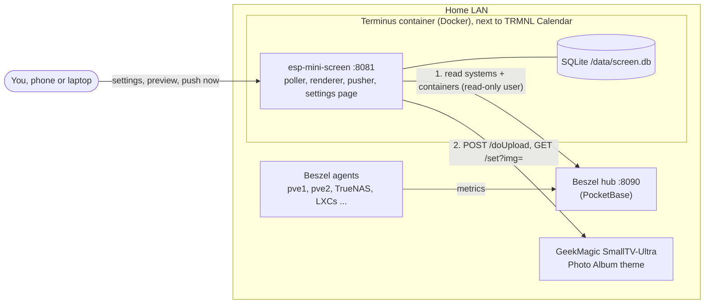
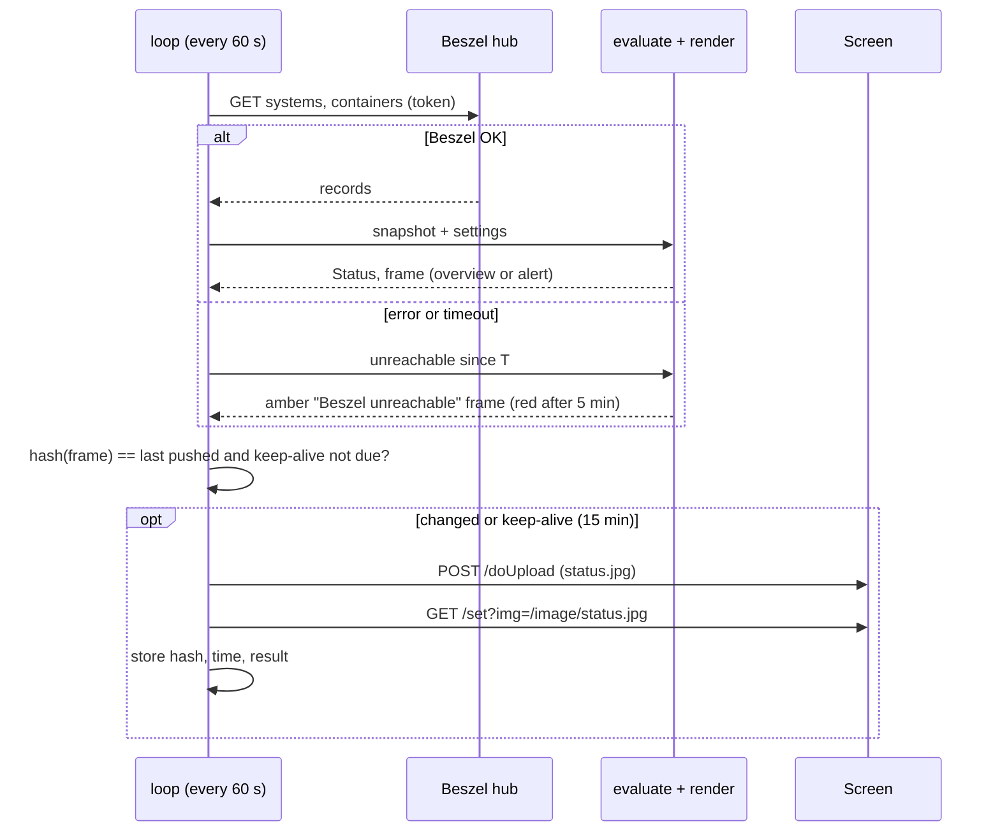

# 05 - Design

Status: **Signed off 2026-11-15.** Nothing is built yet. Tested against Beszel 0.21.2.
Implements `04-requirements.md`. Decisions: ADR-0001 to ADR-0003.

## 1. Context



The app owns the data and the drawing; the screen only displays a JPEG (ADR-0001).
Beszel is the only data source (ADR-0002).

## 2. Components

| Module | Job | I/O? |
|--------|-----|------|
| `beszel/client.py` | Log in as the app user (PocketBase `auth-with-password`), cache the token, refresh on 401. Fetch `systems` and `containers` records. Map raw JSON to domain objects in one place. | HTTP |
| `domain/model.py` | `System`, `Container`, `Snapshot`, `Settings` dataclasses. | none |
| `domain/evaluate.py` | Pure: snapshot + settings + memory of known containers → `Status` (per-row colours, tile counts, list of alerts, overall level). | none |
| `render/` | Pure: `Status` → 240x240 RGB image. `overview()`, `alert()`, `unreachable()`. JPEG encode, quality 85. | none |
| `device/client.py` | Upload to `/doUpload?dir=/image/` with a fixed filename, then `/set?img=`. Read `/album.json`; warn if autoplay is on. Timeouts 5 s, one retry. | HTTP |
| `loop.py` | One asyncio task: every `poll_s` fetch → evaluate → choose frame → render → push if hash changed or keep-alive due. Alternates alert/overview every `alert_flip_s`. | yes |
| `storage/` | SQLite: settings, known containers, push state. Migrations as numbered SQL files (as TRMNL Calendar). | disk |
| `web/` | FastAPI + Jinja server-rendered pages: Settings, Preview (`/preview.jpg`), Push now, `/healthz`. No build step. | HTTP |

Layering rule (tested, as in TRMNL Calendar `test_architecture.py`): `domain` and `render`
import nothing from `beszel`, `device`, `storage` or `web`.

## 3. Main loop



Frame choice: no alerts → overview. Alerts → alternate alert card and overview every
`alert_flip_s` (default 10 s; the loop wakes for the flip, polls still every 60 s). Several
alerts → the card cycles through them, most severe first.

## 4. Status rules

| Item | Amber | Red |
|------|-------|-----|
| System | status `pending` | status `down` (unless "ignore alerts"). **`paused` is never a problem**: left out of counts and alerts |
| CPU, memory % (focus rows) | bar amber >= `warn_pct` (75), red >= `crit_pct` (90) | colour only, never an alert |
| Disk | not shown, not monitored (owner decision 2026-11-15) | none |
| Container | - | an expected container missing for 2 polls, or not running |
| Beszel | unreachable < 5 min | unreachable >= 5 min |

**Expected containers:** every container seen running is remembered in `known_containers`
(system, name, last_seen). One that disappears for 2 consecutive polls is "down" until it
returns or is dismissed on the Settings page ("forget"), or is ticked "allowed to stop".
Tiles: Containers = running / expected; Other systems = up / non-paused systems that are not focus rows, with "n paused" beside it.

## 5. Screens

See `assets/mock-*.jpg` (generator: `assets/make_mockups.py.txt`).

- **Overview:** header (HOMELAB, clock), two tiles (Containers, Other systems), up to three focus rows with CPU and MEM bars and percentages.
- **Overview, 4 focus systems:** compact layout: smaller header, both counters in one strip, four rows (`assets/mock-overview-4.jpg`). Smaller text (names 13 px, labels 10-11 px on a 1.54" panel) reads well at desk distance, less so from across the room. Unused focus slots are
  left empty. Long names are cut to fit (display names are set on the Settings page).
- **Alert:** dark red card, title (e.g. `pve2 down`), one detail line, "since hh:mm (n min)".
- **Unreachable:** amber card, "Beszel unreachable", last good time.
- Fonts: bundled Inter (OFL) so rendering is identical in CI and on the server.
- Frames are flat colour: a few KB each, so uploads stay under a second.

## 6. Settings page

One phone-friendly page, server-rendered:

```
Screen    [ <screen-ip> ]   status: last push 21:45 OK   [Push now]
Preview   [ 240x240 live image ]

Focus systems (1 to 4)            Display name   Ignore alerts
  [x] pve1              ^ v      [ pve1     ]   [ ]
  [x] pve2              ^ v      [ pve2     ]   [ ]
  [x] truenas           ^ v      [ NAS      ]   [ ]
  [ ] terminus                   [          ]   [ ]
  [ ] calendar-lxc               [          ]   [x]
  (new systems appear here unticked)

Thresholds   bar amber [75] %   bar red [90] %
Timing       poll [60] s   alert flip [10] s   keep-alive [15] min
Containers   allowed to stop: [x] watchtower-run ...   known but gone: beszel-old [forget]
[Save]
```

## 7. Data model (SQLite)

| Table | Columns |
|-------|---------|
| `settings` | key, value (JSON). Keys: `device_url`, `warn_pct`, `crit_pct`, `poll_s`, `alert_flip_s`, `keepalive_min` |
| `systems` | beszel_id (PK), beszel_name, display_name, focus_order (null = not focus), ignore_alerts, first_seen, last_seen |
| `known_containers` | system_id, name, allowed_to_stop, last_running, missing_polls (PK system_id + name) |
| `push_state` | id = 1, last_hash, last_push_at, last_result, last_error |
| `schema_version` | version |

Environment (secrets and bootstrap only): `BESZEL_URL`, `BESZEL_USER`, `BESZEL_PASSWORD`,
`SCREEN_URL` (seed for `device_url`), `TZ=America/Halifax`, `HOST_PORT`.

## 8. Deployment

Folder `esp-mini-screen/app/` with `Dockerfile`, `pyproject.toml` (same tooling as TRMNL
Calendar: uv, ruff, pytest) and `deploy/compose.yml`:

```yaml
name: esp-screen
services:
  esp-screen:
    build: { context: .. }
    image: esp-mini-screen:local
    container_name: esp-screen
    restart: unless-stopped
    env_file: .env
    ports: ["${HOST_PORT:-8081}:8080"]
    volumes: [esp-screen-data:/data]
volumes:
  esp-screen-data:
```

Hosted on the existing Terminus container next to TRMNL Calendar (`8080`) and Terminus (`2300`). Deployed by manual pull, as TRMNL Calendar stage 1 (its ADR-0008). Steps: `07-install-and-upgrade.md`. The database is backed up nightly inside the volume (keep 7). Beszel's Docker
monitoring then watches this container like any other. CI: a workflow mirroring
`trmnl-calendar-ci.yml`, path-filtered to `esp-mini-screen/app/**`.

## 9. Testing

- Unit: `evaluate` rules table-driven; container memory across polls; render snapshot
  tests (image hash per fixture, fonts bundled).
- Beszel client: recorded JSON fixtures from the owner's hub (secrets and IPs scrubbed);
  a fake hub (FastAPI) for integration tests, including 401 refresh and timeouts.
- Device client: a fake screen that accepts `/doUpload` and `/set` and records calls.
- One manual end-to-end check against the real screen before declaring a slice done.

## 10. Build slices

See `06-implementation-plan.md` (gate checklist and slices S-0 to S-5).

## 11. Risks

| ID | Risk | Mitigation |
|----|------|------------|
| R-1 | Beszel's API is PocketBase internals; field names (system `info`, `containers` collection) differ by version and may change in minor releases. The owner updates Beszel as releases appear, so this will happen | S-0 records real fixtures (0.21.2); one mapping module; on unexpected data the screen shows a distinct "Beszel data changed" frame and the Settings page names the missing field, instead of showing wrong numbers; check the Beszel release notes before updating |
| R-2 | Screen firmware API is undocumented; a firmware update may change it | Do not auto-update the screen; device client is one small module; `03-device-api.md` records the tested version |
| R-3 | Someone switches the screen theme; dashboard silently hidden | Warn on the Settings page when `/album.json` shows autoplay on; find the theme request and enforce it later |
| R-4 | Flash wear from frequent uploads | Push only on change plus 15-min keep-alive (~100-200 writes/day); one fixed filename |
| R-5 | Device shut off on weak USB power once | 5 V / 1 A adapter; "last push failed" visible on the Settings page; Beszel cannot see the screen, so add an optional ping check later |
