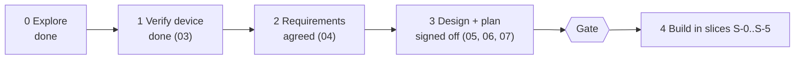

# 06 - Implementation plan

Status: **Signed off 2026-11-15. Gate clear 2026-11-15; S-0 may start.**
Design: `05-design.md`. Install and upgrade: `07-install-and-upgrade.md`.

| Phase | Output | State |
|-------|--------|-------|
| 0 Explore | `00`, `01`, `02` | Done |
| 1 Verify device | `03-device-api.md` (upload and set verified on V9.0.50) | Done 2026-11-14 |
| 2 Requirements | `04-requirements.md` | Agreed 2026-11-14 |
| 3 Design and plan | `05`, `06`, `07`, ADR-0001 to 0003 | Signed off 2026-11-15 |
| 4 Build | Slices below | Not started |

## Gate checklist (all must be ticked before any code in `app/`)

1. [x] Owner signs off `05-design.md`, this plan, `07-install-and-upgrade.md` and ADR-0001 to 0003. Done 2026-11-15 (merged #38, confirmed in chat).
2. [x] Beszel: read-only app user created and all systems shared with it (`07`, "Before install"). Done 2026-11-15.
3. [x] Pi-hole DHCP reservation for the screen (Q-8). Done 2026-11-15.
4. [x] Screen on a 5 V / 1 A (or better) adapter and stable (it shut off once on weak power). Adapter swapped 2026-11-14; stable since.
5. [x] Terminus container has room: free disk >= 3 GB (`df -h /`), free memory >= 200 MB (`free -m`). 2026-11-15: 16 GB free of 30 GB; 1372 MB available of 2048 MB.
6. [x] Port chosen and free on that container (`8081`; the calendar uses `8080`). Free 2026-11-15. The container reaches the screen (HTTP 302 to its settings page) and the Beszel hub by name (`http://beszel:8090/api/health` OK).

S-0 is a read-only spike and may run once items 1 and 2 are ticked.

## Slices

Each slice ends with a check on the real screen or the real hub. Each is one pull request.

### S-0 Beszel contract spike (throwaway script, no app code): **done 2026-11-15** (`08`, fixtures in `app/tests/fixtures/beszel-0.21.2/`)

- Log in as the app user; fetch `systems` and `containers` once. Hub version at gate: **Beszel 0.21.2** (owner updates when releases appear).
- Record scrubbed JSON (no IPs, hostnames kept only if the owner agrees) as test fixtures.
- Confirm field names for: system status, CPU %, memory %, disk %, container name, state, system link.
- Update `05` section 2 and 7 if names differ. Record findings in `docs/08-beszel-api.md`.
- **Done when:** fixtures and `08` are merged; R-1 in `05` updated.

### S-1 Foundations and first push: **done 2026-11-15** (0.1.2 installed; frame on the real screen; install and upgrade steps in `07` ran as written)

- `app/` skeleton mirroring TRMNL Calendar: `pyproject.toml` (uv, ruff, pytest), multi-stage
  non-root `Dockerfile` with bundled Inter font and `HEALTHCHECK`, `deploy/compose.yml`,
  `.env.example`, `/healthz`.
- SQLite + migration runner + `0001_baseline.sql` (settings, systems, known_containers,
  push_state); nightly backup of the database inside the volume (keep 7).
- Device client (`/doUpload`, `/set?img=`, `/album.json`) + fake screen for tests.
- Push a static "hello" frame on start.
- CI workflow `esp-mini-screen-ci.yml` (path filter `esp-mini-screen/app/**`, actions pinned by SHA,
  `permissions: contents: read`).
- **Done when:** installed on the server with `07`; the frame shows on the real screen; `/healthz` green.

### S-2 Live overview: **done 2026-11-15** (0.2.0 installed; live overview on the real screen)

- Beszel client (login, token cache, 401 refresh, timeouts) against S-0 fixtures + fake hub.
- `domain/evaluate.py` (thresholds, tiles) with table-driven tests.
- `render.overview()` with snapshot tests; focus systems read from env for now.
- Loop: read Beszel, render, upload on change; "updated at" HH:MM (24-hour) in the header.
- **Done when:** the real screen shows pve1, pve2 and NAS with live numbers; a change appears within ~1 min.

### S-3 Alerts: **done 2026-11-15** (0.3.1). Container-down and VM-down alerts and recovery verified on the real screen (container alert needed the stale-record fix, docs/08 B-2)

- Container memory (`known_containers`, 2-poll rule, allowed-to-stop).
- `render.alert()`, `render.unreachable()` and the "Beszel data changed" frame (F-16); alert/overview flip with `/set?img=` only; most severe first.
- **Done when:** stopping a test container shows the alert within ~2 min and clears after restart;
  stopping the Beszel hub shows "unreachable" (amber, then red after 5 min).

### S-4 Settings page: **built 2026-11-15** (0.4.0, awaiting install)

- Server-rendered page: focus systems (max 3, order, display name), ignore alerts, thresholds,
  timing, containers (allowed to stop, forget), screen address, preview, Push now, last push status.
- Warn when the screen's album autoplay is on.
- Focus systems move from env to the database (migration 0002 if needed).
- **Done when:** owner picks focus systems from a phone and the screen follows within a minute.

### S-5 Operate

- Run every command in `07` on the real server and correct it; restore drill done once.
- Beszel alert on the `esp-screen` container health (owner).
- 48 h unattended run; check push count (flash wear, R-4) and memory use.
- **Done when:** 48 h with no manual action; `07` marked Verified.

## Later candidates (not planned)

Find the theme and brightness requests and enforce the Photo Album theme; night dimming;
Proxmox API for per-VM/LXC state; extra screens (calendar next event, Pi-hole, TRMNL battery);
publish the image to GHCR (TRMNL Calendar ADR-0008 stage 2).
