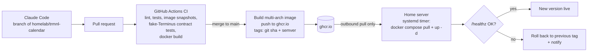

# 12 - Delivery pipeline (code to running server)

Status: **Proposed.** Direction confirmed by the owner: develop and update with Claude Code,
then update the home server with a `docker pull`. Details marked *open* wait for server
answers (see "Open items"). Becomes an ADR (proposed number ADR-0008) once those are settled.


PNG copy: [`assets/delivery-pipeline.png`](assets/delivery-pipeline.png) (for viewers that
do not render SVG).

## Flow in words

1. Work happens in Claude Code on a local clone of `homelab`, on a branch.
2. Push the branch and open a pull request (conventional commit messages).
3. GitHub Actions runs on the PR: lint, unit and recurrence tests, fixed-time image
   snapshot tests, contract tests against a fake Terminus, and a `docker build`.
4. Merging to `main` is allowed only when CI is green.
5. On merge, Actions builds a multi-arch image and pushes it to `ghcr.io`, tagged with the
   git SHA and a semver version.
6. The home server runs a small systemd timer that pulls the pinned tag and runs
   `docker compose up -d`. The server only makes **outbound** requests; no inbound ports.
7. The container healthcheck (`/healthz`) decides: keep the new version, or roll back to
   the previous tag and notify.

## Principles

| Principle | How |
|-----------|-----|
| No internet exposure | Pull-based deploy; the server never accepts connections from GitHub. |
| Few moving parts | One image, one compose file, one timer script. No orchestrator. |
| Reproducible | Base images and GitHub Actions pinned by digest or SHA; Terminus version pinned. |
| Data is never lost | App backs up the SQLite file before applying a migration; nightly `sqlite3 .backup` copy kept elsewhere; versioned migrations. |
| Secrets stay out of git | Server-side `.env` (`chmod 600`). CI uses only the default `GITHUB_TOKEN` to publish to GHCR. |
| Automated upkeep | Dependabot or Renovate PRs for packages, base images and Actions. Terminus upgrade PRs must pass the contract tests. |
| Monorepo friendly | Workflows use path filters on `trmnl-calendar/**`; image tags are namespaced (for example `trmnl-calendar-v1.2.0`). |

## Alternatives considered

| Option | Verdict |
|--------|---------|
| Push over SSH from Actions | Needs an inbound path or a VPN. Rejected for v1. |
| Self-hosted Actions runner on the server | Outbound-only and instant, but runs repo code on the home machine. Acceptable only for a private repo. Possible later upgrade. |
| Updater tool such as Watchtower | Not verified as currently maintained. Not recommended until checked. |
| Server builds from source (`git pull` + `docker build`) | No registry needed, but builds on a small machine and is less reproducible. |

## Repository bootstrap

The `homelab` repo currently holds only the design-repo `.zip`. A zip is not a source of
truth, so extract it and commit the files:

```bash
cd homelab
unzip trmnl-calendar-design-repo.zip -d /tmp/tc
cp -r /tmp/tc/trmnl-calendar/. trmnl-calendar/     # check the extracted folder name first
git rm trmnl-calendar-design-repo.zip              # adjust to where the zip sits
git add trmnl-calendar && git commit -m "docs: import trmnl-calendar design repo"
```

Then add this file, `assets/delivery-pipeline.svg` and `assets/delivery-pipeline.png` under
`trmnl-calendar/docs/`, and turn on branch protection for `main` (require the CI check).

## Open items

| ID | Question | Recommendation |
|----|----------|----------------|
| D-1 | Server CPU architecture, OS, Docker/Compose present, same host as Terminus? | Decides image platforms (amd64 / arm64). |
| D-2 | Is the `homelab` repo public or private? | Public: keep the timer-based pull and avoid a self-hosted runner. |
| D-3 | How are other homelab services deployed today? | Reuse the existing style where workable. |
| D-4 | Deploy automatically on merge, or require approval? | Automatic with automatic rollback. |

## Diagram source (Mermaid, for editing)


