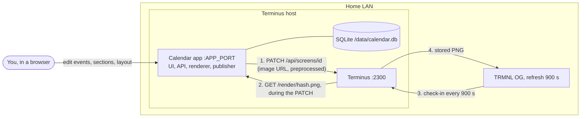
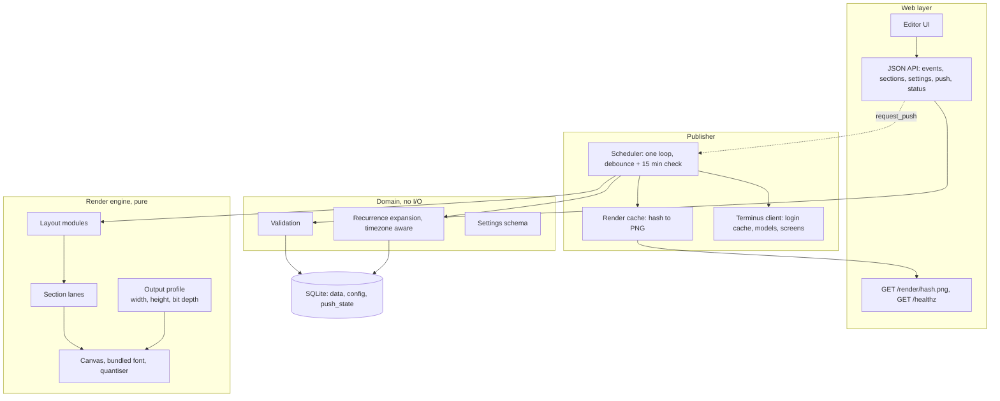
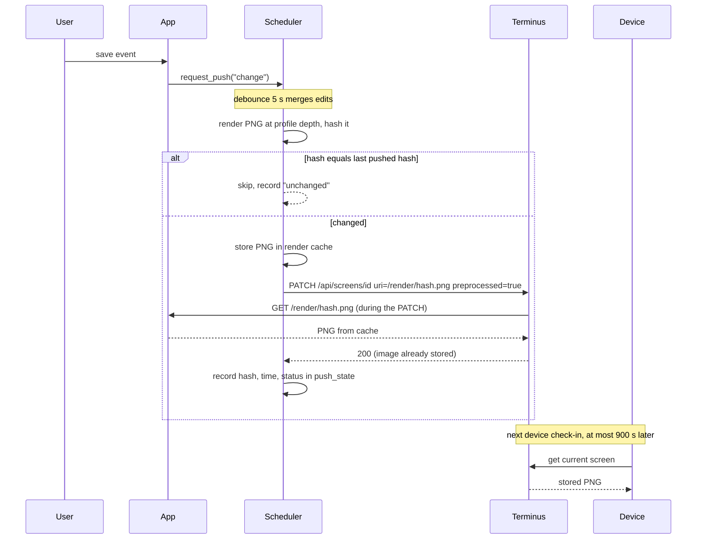
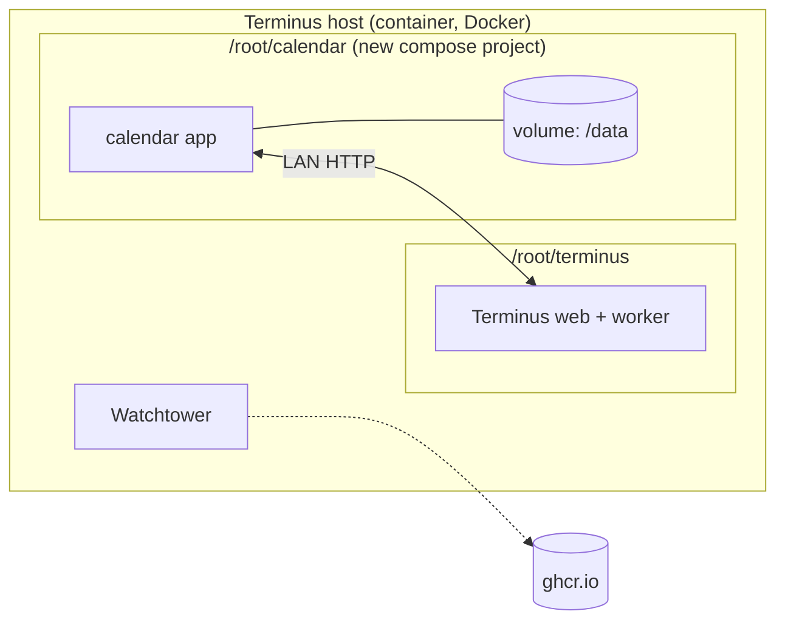

# 02 - Architecture

Status: **Proposed, revised 2026-10-25** after the Terminus spike (`14-terminus-spike-log.md`).
Nothing here is built. Assumptions A-1 to A-3 were confirmed by the owner on 2026-10-25.

## 0. Assumptions and what changed

| ID | Assumption | Basis |
|----|-----------|-------|
| A-1 | **One device and one calendar** in v1; schema leaves room for more (OQ-3). | Confirmed 2026-10-25. |
| A-2 | **Python** for the build; framework decided in a later ADR (OQ-11). | Confirmed 2026-10-25. |
| A-3 | **Manual entry only** in v1; ICS import later through an importer interface (OQ-8). | Confirmed 2026-10-25. |

Changes from the first draft, all driven by verified evidence:

1. The app pushes a PNG with `preprocessed: true`, rendered at the model's exact bit depth
   (2-bit on the owner's `og_plus`). Terminus stores it unchanged.
2. The model is resolved **by name** at run time, not by a fixed id.
3. Terminus fetches the image **during** the PATCH, so the app serves **content-addressed**
   images from a render cache (`/render/<hash>.png`), not a live `/calendar.png`.
4. Publisher state moves **into the database**, and the app pushes **only when the rendered
   image changed**.
5. Closes OQ-7: one process and one worker (asserted at startup), publisher state in the
   database (ADR-0007). The scheduler is one loop; the lease and the separate midnight trigger
   from the first revision were dropped as unnecessary (owner agreed 2026-10-25).

## 1. System context

The app owns the data and the drawing. Terminus is only the delivery channel (ADR-0002).
Verified: a Terminus container reaches an app published on the host's LAN address.

## 2. Components

Rules: `domain/` imports nothing from web, render or publish. `render/` takes plain data plus a
fixed `now` and returns an image; it never touches the database. Only `publish/terminus.py`
knows Terminus's API. (Folder layout: `app/README.md`.)

## 3. Push sequence

Why content-addressed URLs: the image cannot change between render and fetch, a retry fetches
identical bytes, and the 200 can be matched to a specific hash. Why a cache: the endpoint
never re-renders and never needs the scheduler's lock, so Terminus's callback cannot
deadlock a push that is waiting on it. **Rule:** the push call runs off the request loop (a
worker thread or non-blocking client) and the image route is non-blocking.

## 4. Scheduler

| Trigger | Action |
|---------|--------|
| Data, section or setting changed | wake the loop, debounce 5 s, render, push if hash changed |
| Every 15 minutes | render, push only if the hash changed. This also moves the "today" marker at local midnight and retries after a failure |
| Startup | render and push if the stored hash differs from what Terminus holds |
| Manual "Push now" | render and push even if unchanged |

A device checks in every 900 s, so pushing more often gains nothing. Pushing only on a hash
change keeps Terminus's uploads and e-paper redraws to what actually changed.

## 5. State, config and the process model

- **One application process and one worker**, so one scheduler; startup asserts a single worker
  and refuses to run background push otherwise. State lives in tables, not memory: `push_state`
  (last hash, time, status, error, Terminus screen id), so the UI status page survives restarts.
  (ADR-0007.)
- **Config in the database** (layout, sections, timezone, push interval, profile choice).
  **Environment** holds infrastructure and secrets only: `TERMINUS_URL`, `TERMINUS_LOGIN`,
  `TERMINUS_PASSWORD`, `PUBLIC_BASE_URL` (the address *Terminus* uses to reach the app),
  `DATA_DIR`, `TZ`. (ADR-0005.)
- **Terminus client:** log in lazily, cache the access token about 25 minutes, refresh through
  `POST /api/jwt`, fall back to a fresh login. Resolve the model by name (`og_plus`) at startup
  and after a failed push. If the stored screen id returns 404, look for a screen named
  `trmnl-calendar`, else create one.
- **Output profile:** `{model name -> width, height, bit depth}` read from Terminus, with a
  manual override. Layouts size themselves from the profile; the quantiser maps the drawing to
  1 or 2 bits. Default: **2-bit with the device's Display Compatibility setting on** (owner saw
  no ghosting with it, spike S-5). Pushing only on a changed hash keeps transitions rare.
- **Time:** events are stored as local wall-clock dates and times in the calendar's IANA
  timezone (default America/Halifax); the timezone only decides what "today" and "now" are.
  System timestamps are UTC. Details: `03-data-model.md` and ADR-0010.

## 6. Deployment and delivery

- The calendar app is its own compose project beside Terminus, with a data volume, a
  `/healthz` check and no inbound exposure. Its image comes from GHCR (`12-delivery-pipeline.md`).
  Whether Watchtower or a pinned tag updates it is still open (D-4).
- Disk on this host is tight (3.4 GB free, `13-infrastructure.md` P-7); resolve before the
  first deployment. The image should stay small (Python slim, bundled font only).
- App port is a placeholder (`APP_PORT`); pick one that is free (2300, 5432, 6379 and 45876
  are in use).

## 7. Failure modes

| Failure | Behaviour |
|---------|-----------|
| Terminus unreachable or login fails | record error in `push_state`, show it in the UI, retry at the next heartbeat with backoff |
| PATCH returns an error | keep the previous screen on the device, record the response body, retry |
| Screen id is 404 | find by name or recreate, store the new id |
| Model name missing from `/api/models` | refuse to push, show a configuration error (do not guess a depth) |
| Render error (bad data) | keep the last good image, show the error, never push a broken image |
| App restarts mid-push | `push_state` shows "in progress", the next run re-checks and pushes if needed |
| Device offline | no effect on the app; the device catches up at its next check-in |

## 8. Extension points (the "modular" requirement)

| Point | Design |
|-------|--------|
| New layout | Module registered by name implementing `render(ctx) -> image` (`04-rendering-design.md`) |
| New output device or depth | A new output profile; layouts do not change |
| New delivery target | `Publisher` interface: push via the Screens API (default) and a pull-mode trial (E-1) |
| New event source | `Importer` interface (ICS first, later) |
| New setting | Declarative settings schema driving validation, API and UI form |

## 9. Security position (no login in v1)

Acceptable on a trusted home LAN, with two caveats. Anyone on the LAN (guests, IoT devices)
can edit or delete events, and can trigger pushes. The app holds Terminus credentials, so it
must never return them through the API or logs. Recommendation: bind to the LAN only, never
publish the port outside, and add an optional single shared password (HTTP basic) in a later
slice; it is cheap.

**Terminus credentials (proposed):** the app logs in as its own, dedicated Terminus user. Terminus's
README says the first user gets full access, later users must be verified manually, and finer
roles and permissions are not yet available, so a dedicated user gives a separate, revocable and
rotatable credential, **not** least privilege. The password lives in the server's environment
or a `chmod 600` secrets file (`TERMINUS_LOGIN`, `TERMINUS_PASSWORD`), **not in the SQLite
database**: the key to decrypt it would sit on the same host, and backups of the database
would otherwise carry the secret. If a setup screen is wanted later, store it encrypted with a
key from the environment. Credentials are never sent to the browser, logged, or pasted into
chat.

## 10. Alternatives

- **Pull mode (under evaluation, experiment E-1 in ADR-0003).** The app serves a stable
  `GET /calendar.png` (latest render) and a Terminus poll extension fetches it on a schedule.
  No credentials or publisher would be needed, but it cannot push "only when changed". It is a
  second implementation behind the `Publisher` interface, trialled after slice 4.
- **HTML-template extension (option B) and a device-protocol server (option C)** are not
  planned (`05-terminus-integration.md`).
