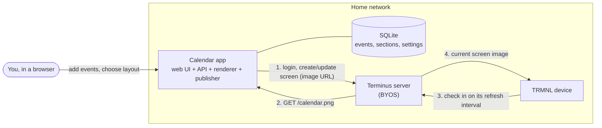
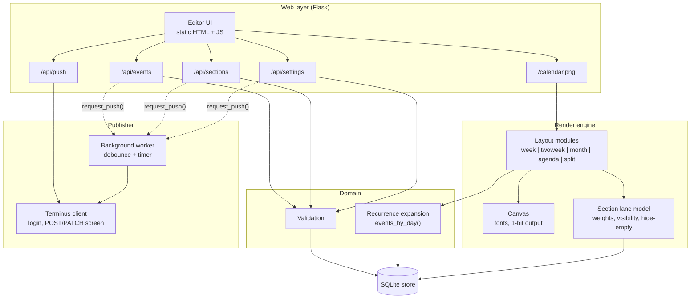
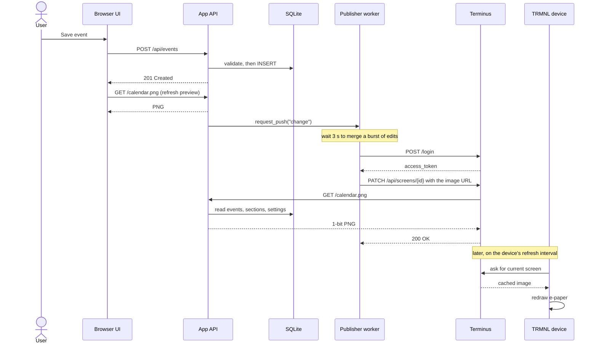
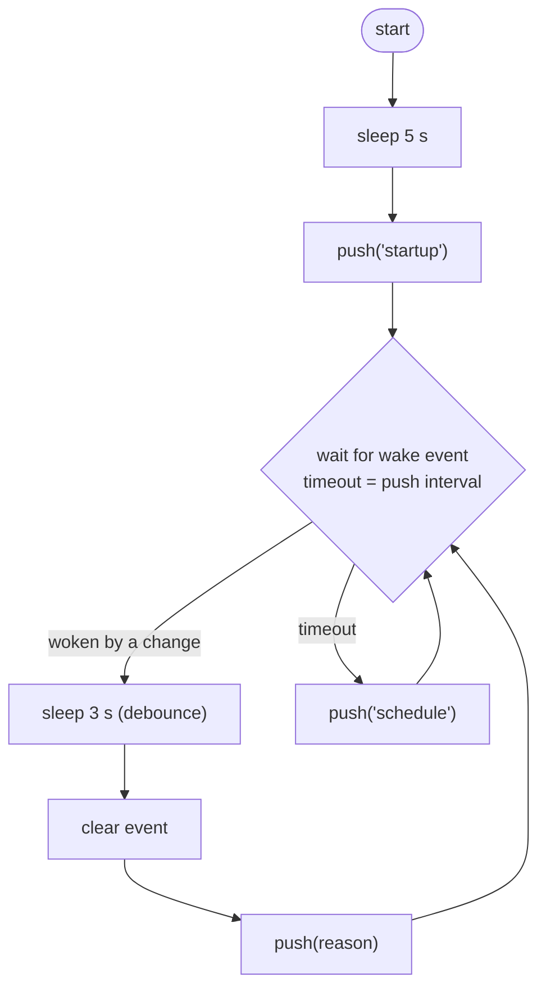
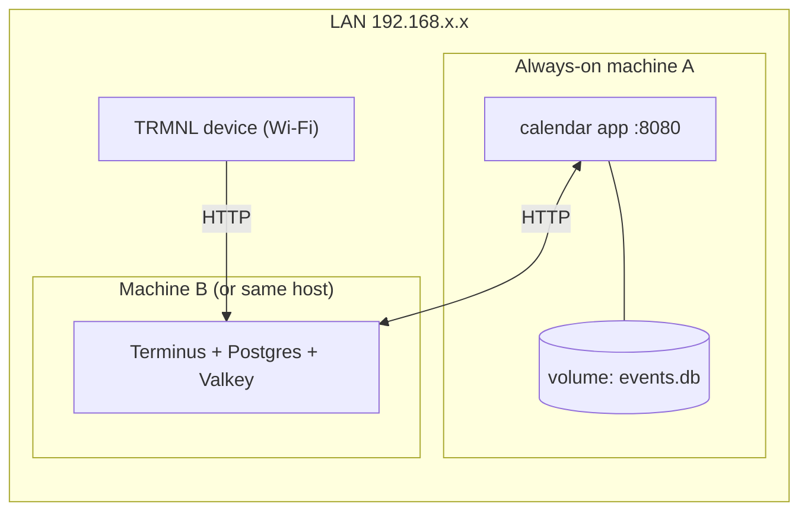

# 02 - Architecture

Status: **proposed**. The prototype implements most of this, but the design is meant to be
reviewed and changed before production code is written.

## 1. System context

Key idea: the **app owns the data and the drawing**. Terminus is treated as a delivery
channel. This keeps layout logic out of Liquid templates and lets the app be developed and
tested without a device. (ADR-0002, ADR-0006)

## 2. Components inside the app

Prototype note: in the prototype, `store.py` holds both storage and domain logic, and
`render.py` holds canvas, lanes and every layout. The split above is a **proposed**
separation; see `app/README.md` for the target folder structure.

## 3. Sequence: adding an event through to the device

Consequence: a new event reaches the device only on its **next check-in**. The delay is
bounded by the device refresh interval (Terminus's example shows 900 s), not by this app.

## 4. Publisher worker loop

`push()` never raises; it records `{state, message, at}` for the UI. First push creates the
screen and stores its id in the database; later pushes PATCH that id; a 404 recreates it.

## 5. Process and threading model

- The publisher is an in-process daemon thread with **in-memory status**. That forces **one
  application process** (for example `gunicorn --workers 1 --threads 4`). Two workers would
  push twice and show different statuses.
- Terminus calls back into the app while the push request is still open (it fetches
  `/calendar.png` during the PATCH), so the app needs **at least two request threads**.
- Alternative to evaluate: a separate publisher process or a cron-style job that calls
  `/api/push`, which removes the single-process constraint. (Open question OQ-7.)

## 6. Deployment (home network)

- The image address Terminus uses (`TERMINUS_IMAGE_URL`) must be reachable **from Terminus**,
  which may differ from the address your browser uses. If Terminus runs in Docker, `localhost`
  is wrong.
- Give both machines DHCP reservations so addresses do not change.
- Do not expose the app to the internet: it has no authentication.

## 7. Extensibility points (the "modular" requirement)

| Extension point | Today | Proposed |
|-----------------|-------|----------|
| New layout | Add a branch in `render_png()` | Layout modules registered by name, each implementing `render(ctx) -> Canvas`. See `04-rendering-design.md`. |
| New section behaviour | Fields on `sections` table | Same table; add columns via migrations. |
| New setting | Add key to `DEFAULT_SETTINGS` + choice list | A declarative settings schema (key, type, default, choices, description) that drives validation, the API and the UI form. |
| New delivery target | Not possible | A `Publisher` interface; Terminus is one implementation (could add "write PNG to disk", "webhook"). |
| New event source | Manual entry only | An importer interface (ICS first). |

## 8. Alternative architecture to compare (not built)

**Terminus-native extension** (see `05-terminus-integration.md`, option B): the app only stores
and serves JSON (`/api/upcoming`); Terminus polls it on a schedule and renders a Liquid
template. Removes the push step and the Pillow renderer, but moves all layout work into
Liquid/HTML and couples the project to Terminus's extension format.
