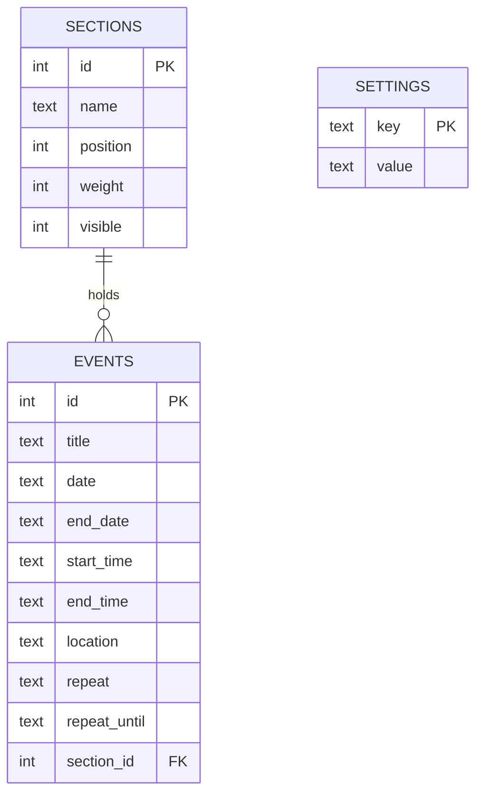

# 03 - Data model

Storage is a single SQLite file (`events.db`). Three tables. Everything the user can
configure lives here, so a restart or container rebuild loses nothing.

## events

| Column | Type | Meaning |
|--------|------|---------|
| `date` | `YYYY-MM-DD` text | First day. Local calendar date; **no timezone stored**. |
| `end_date` | text or NULL | Last day of a multi-day event. NULL if single day. |
| `start_time`, `end_time` | `HH:MM` text or NULL | `start_time` NULL means all-day. `end_time` optional. |
| `repeat` | `none, daily, weekly, monthly, yearly` | Recurrence rule. |
| `repeat_until` | text or NULL | Last allowed **start** date. NULL means forever. |
| `section_id` | int | Which section row the event appears in. Backfilled to the first section on migration. |

Validation rules (prototype): title 1-120 chars; end date after start date; times `HH:MM`;
end time after start time on single-day events; end time requires start time; location up
to 120 chars; repeat-until not before the first date; `section_id` must exist (defaults to
the first section).

### Recurrence expansion

`events_by_day(start, end)` expands every event into per-day entries for the window.

- Multi-day events appear on every covered day; time is shown on the first day only.
- Monthly on the 29th-31st is **skipped** in months without that day (it is not clamped).
- Yearly on 29 Feb is skipped in non-leap years.
- There are **no exceptions**: you cannot skip or edit one occurrence of a repeating event.

Open: is skip-versus-clamp the right behaviour, and are per-occurrence exceptions needed? (OQ-5)

## sections

| Column | Meaning |
|--------|---------|
| `name` | 1-30 chars, unique ignoring case. |
| `position` | Display order, top to bottom. |
| `weight` | Relative height 1-4. A weight-2 section is twice as tall as weight-1. |
| `visible` | Hidden sections are not drawn and their events do not appear on the image. |

Seeded on first run: Events, Work, Lunch, Dinner (all weight 1, visible). Up to 8 sections.
Deleting a section re-homes its events to the first remaining section. At least one must remain.

## settings

Key-value, values stored as JSON. Only known keys are exposed; keys starting with `_` are
internal (for example `_terminus_screen_id`).

| Key | Type / choices | Default | Notes |
|-----|----------------|---------|-------|
| `view` | `week, twoweek, month, agenda, split` | `month` | What `/calendar.png` draws when no `?view=` is given. |
| `week_start` | `sun, mon` | env `WEEK_START` or `sun` | |
| `time_format` | `12, 24` | env `TIME_FORMAT` or `12` | |
| `show_weekends` | bool | true | Honoured by week, two-week, month. Ignored by agenda and split. |
| `show_section_labels` | bool | true | Gutter labels in week views; legend line in month. |
| `hide_empty_sections` | bool | false | Drops sections with no events in the visible range and reflows heights. |
| `show_updated` | bool | true | "Updated 2:05 PM" stamp. |
| `_terminus_screen_id` | internal | none | Remembered after the first push. |

**Environment variables only seed defaults and hold infrastructure and secrets.** Once a
value is saved in the database, the database wins. (ADR-0005)

## Migrations

Prototype: `init_db()` runs `CREATE TABLE IF NOT EXISTS`, adds `events.section_id` with
`ALTER TABLE` if missing, seeds sections, and backfills events. This is ad hoc.

Decision needed: a real migration mechanism (numbered SQL files with a `schema_version`
table, or a library) before the schema changes again. (OQ-9)

## Deliberately not modelled yet

Multiple calendars, per-section styling (icons, patterns), event notes/description, time
zones per event, attachments, audit history.
