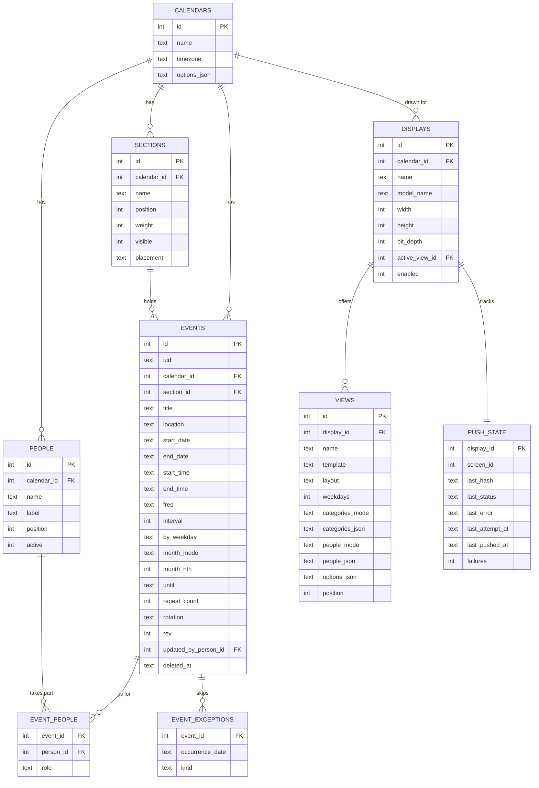

# 03 - Data model

Status: **Proposed, revised 2026-10-25 (second revision).** Folds in the owner's decisions on
views, people, recurrence, multi-day events and the manage experience (`15`, `17`). Storage is one
SQLite file in WAL mode. Everything the user can configure lives here, so a restart or rebuild
loses nothing. Secrets do not (ADR-0005 addendum).

> **Built so far (migrations 0001-0006, slices 1-4):** `calendars`, `sections` (seeded), `events`, `event_exceptions`,
> `idempotency_keys`, `people`, `event_people`, `displays` (one seeded row: `og_plus`, 800 x 480, 2-bit), `views`
> (two seeded: Week - lanes and Two weeks - list), `push_state` (one row: last hash, status, error, times, failures,
> Terminus screen id).
> `calendars.options_json` holds timezone-adjacent options (week start, time format). `events.updated_by_person_id`
> is a plain integer with no foreign key, so retiring or deleting a person never blocks history.

## 1. Entities

One calendar and one display exist in v1 (A-1). Every table that belongs to a calendar carries
`calendar_id`, so a second calendar or device is added with rows, not a redesign. v1 code uses a
single constant calendar id. Timestamps are omitted from the diagram; see conventions.

## 2. Conventions

- **Strict tables.** SQLite `STRICT` tables with `CHECK` constraints for enumerations; foreign keys
  on; WAL; busy timeout.
- **Dates and times.** Event dates are `YYYY-MM-DD`, times `HH:MM` (24-hour), text. System
  timestamps (`created_at`, `updated_at`, `deleted_at`, push times) are UTC ISO-8601 with `Z`.
- **Floating local time (ADR-0010).** An event happens at a wall-clock time in the calendar's
  timezone. No per-event timezone and no UTC conversion. The timezone only decides "today" and
  "now". Changing the calendar timezone keeps events' wall-clock times.
- **Identity.** Integer primary keys, plus `events.uid` (UUID text) as a stable identity for a later
  ICS import and export.
- **Tolerant reading.** JSON option columns are validated against schemas declared in code. Missing
  options take defaults; unknown options are kept and ignored; invalid values fall back and are
  logged. Ids that point at deleted rows are ignored.

## 3. Tables

### calendars
`name`, `timezone` (IANA, default from `TZ` on first run: America/Halifax), `options_json`:
`week_start` (`sun` or `mon`, default `sun`) and `time_format` (`12` or `24`, default `12`).

### sections (shown to users as "categories"; ADR-0004)
| Column | Rule |
|--------|------|
| `name` | 1 to 30 characters, unique per calendar ignoring case |
| `position` | display order |
| `weight` | relative height 1 to 4 (lane layouts) |
| `visible` | hidden categories are not drawn and their events do not appear |
| `placement` | `lane` (default) or `banner`: a banner category draws as a strip at the top of the day, for whole-day items such as holidays |

Seeded: Events, Work, Lunch, Dinner (lanes). Service limit: 8 categories. At least one must exist.
Deleting one needs a target: its events move to the chosen category.

### people
`name` (1 to 30 characters), `label` (1 or 2 characters, unique per calendar, drawn on the screen),
`position`, `active`. Service limit: 10. Deactivating a person hides them from new events and
filters but keeps old events intact. There are no passwords: a browser remembers "who am I" in a
cookie (`15`, M-1); the server stores nothing about devices.

### events
| Column | Meaning |
|--------|---------|
| `title` | 1 to 120 characters (the "description" in the add form) |
| `location` | optional, up to 120 characters |
| `start_date` | first day |
| `end_date` | last day of a multi-day event (a trip); NULL for a single day |
| `start_time`, `end_time` | NULL `start_time` means all-day. On a multi-day event `start_time` applies to the first day and `end_time` to the last day (R-3, decided) |
| `section_id` | exactly one category |
| `freq` | `none`, `daily`, `weekly`, `monthly`, `yearly` |
| `interval` | every N units, 1 to 99 (default 1). Biweekly = weekly with interval 2 |
| `by_weekday` | weekly: comma list such as `MO,WE,FR` (NULL = the start date's weekday). Monthly by weekday: the single weekday code |
| `month_mode` | monthly only: `date` (default) or `weekday` ("first Monday", "last Friday") |
| `month_nth` | with `month_mode = weekday`: 1 to 4, or -1 for the last |
| `until` | last date an occurrence may **start** on; NULL means forever |
| `rotation` | optional JSON list of weeks of weekday codes, for example `[["MO","TU","FR","SA","SU"],["WE","TH"]]` (migration 0007). Set means a rotating-week schedule: `freq` is `weekly`, `interval` is the number of weeks, `by_weekday` is empty. Week A is the Monday-to-Sunday week containing `start_date`; weeks always run Monday to Sunday whatever the calendar's week start is. 2 to 4 weeks; a week may be empty. |
| `repeat_count` | alternative to `until`: stop after this many occurrences (2 to 999; the first counts, skipped dates still count); NULL means no limit. At most one of `until` and `repeat_count` is set (migration 0006). |
| `rev` | integer, incremented on every save; used to warn about simultaneous edits (`15`, M-8) |
| `updated_by_person_id` | the profile that last saved it, or NULL |
| `deleted_at` | soft delete; set when removed, NULL otherwise (`15`, M-5) |

Validation: dates in 1970 to 2100; `end_date` not before `start_date`; on a single-day event
`end_time` after `start_time`; `until` not before `start_date`; when `freq` is `none`, `interval`
is 1 and the weekday, month and `until` fields are NULL; `by_weekday` only with `weekly` (any set)
or `monthly` with mode `weekday` (exactly one); `month_mode` and `month_nth` only with `monthly`.

Deleted events are excluded from every query and expansion. A "Recently deleted" list shows them for
30 days; a daily job then purges them and their exceptions and people links.

### event_people
`(event_id, person_id, role)`, role `owner` or `with`. Zero rows means **everyone**. At most one
owner per event (a partial unique index). The owner is drawn first and highlighted; the others
follow. In the add form, picking one person makes that person the owner; "Main person" under More
sets it explicitly when several are chosen.

### event_exceptions
`(event_id, occurrence_date, kind)`; v1 supports `kind = 'skip'` only ("not this Tuesday"). Reserved
so a later `override` is additive.

### displays
The render target and its profile: `model_name` (a Terminus model name such as `og_plus`), `width`,
`height`, `bit_depth` (read from Terminus, overridable), `enabled`, and `active_view_id`, the view
currently shown on the device (NULL means the first view). Seed: `og_plus`, 800x480, 2-bit.

### views (new)
A saved way of drawing the calendar. A display can have many; one is active.

| Column | Meaning |
|--------|---------|
| `name` | user-chosen ("Work week") |
| `template` | which built-in template it started from; informational only |
| `layout` | registered layout module name (for example week lanes, two-week list) |
| `weekdays` | integer 0 to 127, one bit per day of the week, any subset (presets are shortcuts) |
| `categories_mode` | `all` (new categories appear automatically) or `only` |
| `categories_json` | category ids when `only` |
| `people_mode`, `people_json` | the same for people |
| `options_json` | what to show (times, person badges, locations, holiday banner, hidden-day marker, hide empty lanes, ...) plus the layout's own options |
| `position` | order in the list |

The range (one week, two weeks, month) belongs to the layout. **Templates live in code**, not the
database: "Week - lanes", "Two weeks - list" and "Blank" each produce a starting set of values that
is copied into a new view. Adding a template or layout needs no migration (`16`, `17`).

### idempotency_keys
`(key, method_and_path, status, response_json, created_at)`. Lets a create be retried safely (`06`): a repeat
with the same key within 24 hours returns the stored response and creates nothing. Rows older than 24 hours
are purged by the daily job.

### push_state, schema_migrations
Unchanged from the first revision: one `push_state` row per display (Terminus `screen_id`, last
hash, status, error, times, consecutive failures), and `schema_migrations` (version, applied time).

## 4. Occurrence expansion

A pure function in the domain layer, with no database access:

`occurrences(events, exceptions, window_start, window_end) -> list[Occurrence]`

An `Occurrence` carries `event_id`, `uid`, `title`, `location`, `section_id`, the people (owner
first), `date`, times, `all_day`, and for multi-day events `day_number`, `day_count`, `is_first`
and `is_last`. Layouts turn consecutive days of one multi-day event into a bar (`17`).

Rules:
- Every occurrence keeps the event's duration in days.
- **Weekly with an interval** counts weeks from the week of `start_date` using `week_start`.
- **Monthly by date** repeats on the start day of the month; shorter months **clamp to the last
  day** (ADR-0010). **Monthly by weekday** is the nth (1 to 4) or last such weekday of each month.
  If the start date does not fall on that pattern, the first occurrence is the first matching day on
  or after it.
- **Yearly** on 29 February clamps to 28 February in non-leap years.
- Skipped dates (`event_exceptions`) and soft-deleted events are removed.
- Order inside a day and category: all-day first, then by start time, then title, then id.
- Only the requested window is generated.

Test fixtures cover each rule: leap years, month ends, clock changes, window edges, `until`
boundaries, skips, multi-day spans across rows and hidden days, and nth and last weekdays.

## 5. Migrations (closes OQ-9)

Numbered SQL files applied in order, in a transaction, by a small runner that records each in
`schema_migrations`. Before any migration the app copies the database file to `/data/backups/`
(`VACUUM INTO`). Forward-only; a bad migration is undone by restoring that copy. CI tests a
migration from every earlier schema using fixture databases. If the prototype's `events.db` ever
holds data worth keeping, a one-off importer is written on request.

## 6. Backups

Nightly online copy into `/data/backups/` (14 daily, 8 weekly) plus a copy off the container
(`13-infrastructure.md`). Restore is a documented, tested procedure. The 30-day recently-deleted
window is a convenience, not a backup.

## 7. Deliberately not modelled

Multiple calendars in the UI, event notes, per-category icons, attendees, reminders, attachments,
per-occurrence overrides and "this and following" edits, time zones per event, an audit history, and
accounts or passwords. Each can be added later without reshaping the tables above.

### event_day_notes (migration 0007)

`(event_id, day, note)`, primary key `(event_id, day)`; `note` is `in` or `out`; deleted with the event.
`day` is the occurrence's start date. The note is shown as a suffix on that day's title ("Work (out)")
and no row means "not decided". Days off use the existing `event_exceptions` skips.

### device_samples (migration 0008)

`(at, voltage, wifi, seen_at)`, primary key `at` (UTC text). One reading of the screen's battery voltage
and Wi-Fi signal, copied from Terminus's device record at most once per device check-in and at least five
minutes apart; rows older than 90 days are deleted. Not part of `GET /export` (derived data, kept by backups).
