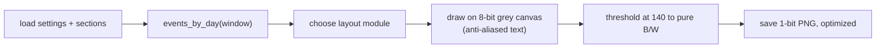
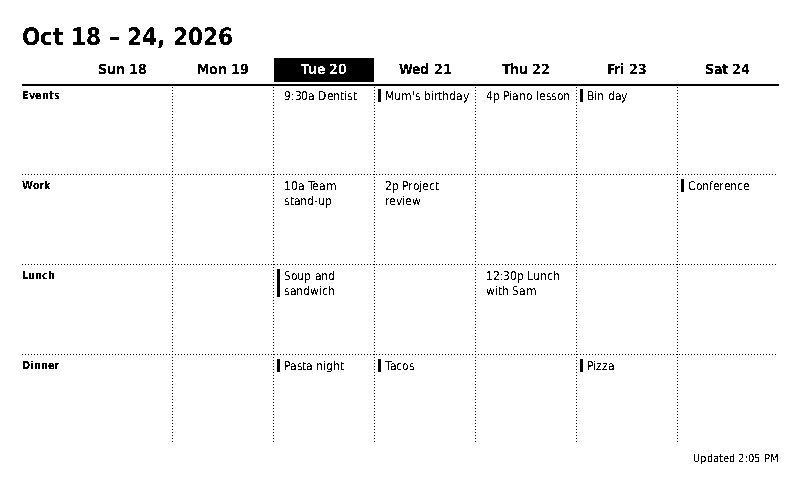
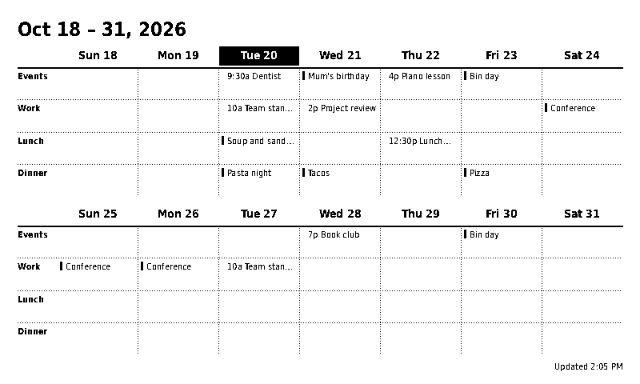
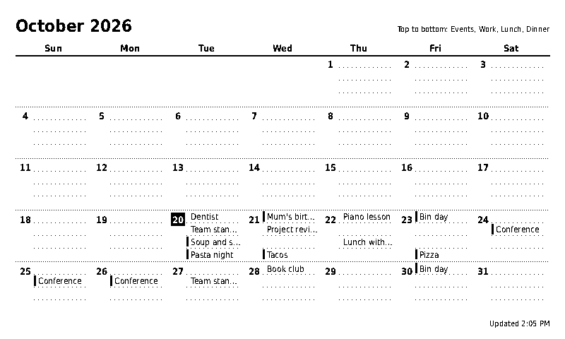
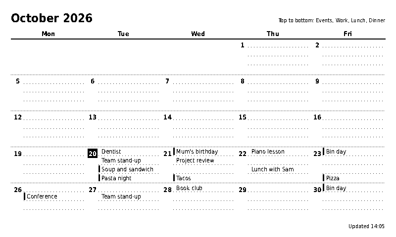
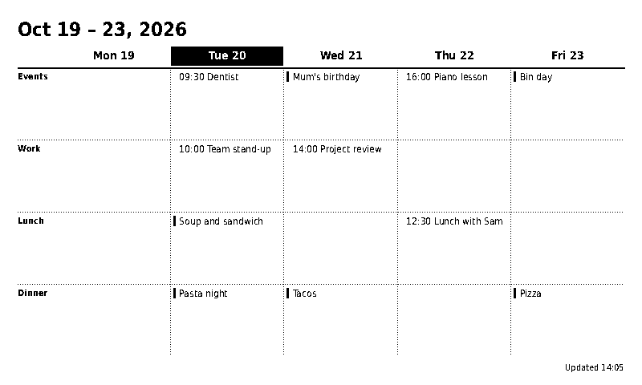
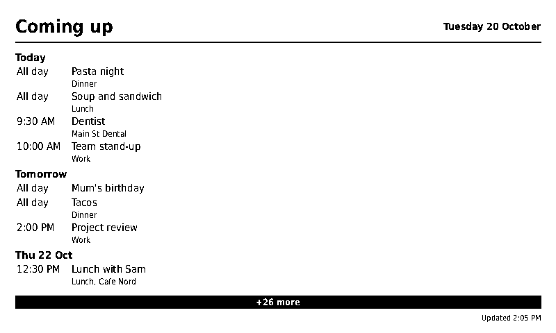
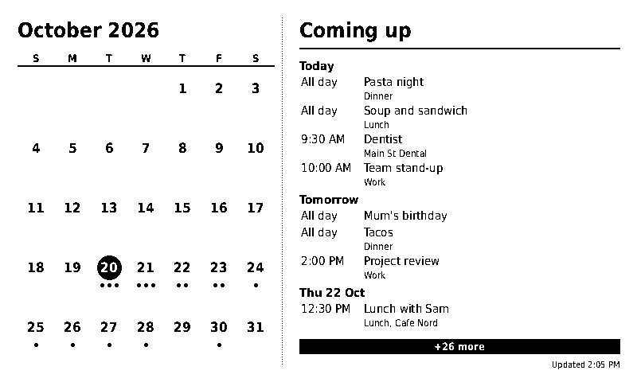

# 04 - Rendering design

The renderer turns `(events, sections, settings, now)` into a PNG. It is the part of the
prototype that is furthest along, and the part where design decisions are most visible.

## Pipeline



- Layouts are designed on an **800x480** reference canvas. A scale factor `s = height / 480`
  scales sizes for other heights. Only 800x480 (and one 400x240 smoke test) were checked.
- Output is **1-bit**. The Terminus walkthrough lists the OG model as 2-bit, so Terminus may
  re-process our image. Not yet verified. (OQ-1)
- Rendering is a pure function of its inputs plus `now`, so it can be snapshot-tested.

## Section lanes

A **section** is a horizontal lane inside every day. Heights are proportional to `weight`.

```
total lane height  H
weights            [1, 1, 2, 1]
unit               H / 5
lane heights       [1u, 1u, 2u, 1u]   (top to bottom, in `position` order)
```

Rules:
1. Only `visible` sections are drawn.
2. With `hide_empty_sections`, sections with no events in the displayed range are dropped and
   heights are recomputed over the rest (at least one section always remains).
3. Events whose `section_id` is unknown fall back to the first section.
4. Within a lane, all-day entries are marked with a solid bar; timed entries are prefixed with a
   short time (`9a`, `9:30a`, `17:30`).

## Layouts

### Week (7 or 5 columns, sections as labelled rows)

```
+---------------------------------------------------------------------+
| Oct 18 - 24, 2026                                                   |
|          | Sun 18 | Mon 19 | [Tue 20] | Wed 21 | Thu 22 | Fri 23 | .. |
|==========+========+========+==========+========+========+========+====|
| Events   |        |        | 9:30a    | |Mum's | 4p     | |Bin   |    |
|          |        |        | Dentist  | birth- | Piano  | day    |    |
| - - - - -+ - - - -+ - - - -+ - - - - -+ - - - -+ - - - -+ - - - -+ - -|
| Work     |        |        | 10a Team | 2p     |        |        |    |
| Lunch    |        |        | |Soup .. |        | 12:30p |        |    |
| Dinner   |        |        | |Pasta   | |Tacos |        | |Pizza |    |
+---------------------------------------------------------------------+
                                                      Updated 2:05 PM
```
Titles wrap to two lines. Today's header is inverted.
Sample: 

### Two weeks (two stacked week blocks, titles do not wrap)
Sample: 

### Month (sections as one line each inside every date cell)

```
+---------------------------------------------------------------------+
| October 2026                      Top to bottom: Events, Work, Lunch, Dinner |
|   Sun     Mon     Tue     Wed     Thu     Fri     Sat               |
|=====================================================================|
| 18 ....  19 ....  [20] Dentist  21 |Mum..  22 Piano  23 |Bin   24 .. |
|    ....     ....       Team st..     Project         ....   ....     |
|    ....     ....       |Soup..       ....        Lunch w.. ....      |
|    ....     ....       |Pasta        |Tacos        ....   |Pizza      |
```
Each lane shows its first entry plus `+N` when there are more. A legend line in the title bar
names the lanes top to bottom, because there is no room for per-cell labels.
Sample: 

Same data with Monday start, weekends hidden, 24-hour time:



### Agenda and Split (carried over from the first version)

Agenda lists upcoming days; Split shows a compact month with dots on the left and the agenda
on the right. Both append the section name to the small second line when the event is not in
the first section.




## Lessons learned (keep these)

1. **No small inverted text.** White 11-px text on black smears into mush after thresholding
   ("Bin day" read as "Bin gay"). All-day events use a solid left bar instead.
2. **Dotted rules are drawn pixel by pixel** to stay crisp; solid lines use width scaling.
3. **Month lane font size is derived from lane height**, clamped to 9-12 px. Tested only with
   up to 4 sections; the product allows 8, which will need a real policy (shrink, abbreviate,
   or switch to dots).
4. **Truncation uses an ellipsis by measured pixel width**, not character count.
5. Hiding weekends gives the remaining columns more room, which markedly improves legibility.

## Known problems

| Problem | Detail |
|---------|--------|
| Font in Docker | The renderer prefers `DejaVuSansCondensed*.ttf`. The prototype Dockerfile installs `fonts-dejavu-core`, which **probably does not include the Condensed files** (they are in `fonts-dejavu-extra`). The fallback is the wider `DejaVuSans`, so layouts would differ from the samples. Verify, then either install the right package or **bundle a font file** in the repo (the DejaVu license permits it). |
| No tests | Visual checks only. Needs snapshot tests with a fixed `now` and fixture data. |
| Bit depth | 1-bit vs 2-bit grey not decided. 2-bit would allow light hatching and grey separators. |
| Single resolution | Other models (larger or different aspect ratio) are untested. |

## Proposed layout module interface (design, not code)

```
LayoutContext:
  today, now        dates
  by_day            {date: [entry]}            from events_by_day
  sections          ordered, visible-filtered
  settings          the settings dict
  canvas            Canvas (w, h, scale, fonts)

Layout:
  name              "week" | "month" | ...
  label             shown in the UI
  window(today)     -> (start, end)   data range needed
  render(ctx)       -> draws on ctx.canvas
  options           optional per-layout settings schema
```

Layouts register themselves by name. The settings form lists registered layouts, so adding one
does not touch the API or UI code. (ADR-0004, ADR-0006)

## Alternative to evaluate: HTML to image

Render an HTML/CSS page in a headless browser and screenshot it. Pros: CSS layout, easy text
wrapping, same technology Terminus uses for its own HTML screens. Cons: heavy dependency
(Chromium), slower, harder to guarantee crisp 1-bit output. Pillow was chosen for the
prototype for being light and deterministic. (ADR-0006)
