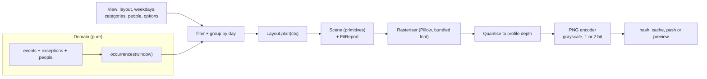

# 04 - Rendering design

Status: **Proposed, revised 2026-10-27.** Replaces the prototype-era draft. Inputs: the Terminus
spike (`14`), the six layout options shown on the owner's panel (`16`), views, people and trips
(`15`, `17`) and the data model (`03`). Nothing here is built.

## 1. What changed from the first draft

| First draft | Now | Why |
|-------------|-----|-----|
| Output 1-bit | **2-bit grayscale PNG** (1-bit selectable) | Verified: Terminus stores a preprocessed PNG unchanged and the panel shows four greys (`14`, S-1, S-5) |
| Draw, then threshold at 140 | Draw crisp text on a **four-level** canvas, quantise to the profile's depth | Owner's panel looks good with crisp 11 to 12 px text |
| Layout draws straight onto Pillow | **Two phases**: a layout *plans* a scene, a generic rasteriser *draws* it | Enables a fit check, JSON snapshot tests and a preview with no duplicate code |
| One `view` setting | **Views** (layout, weekdays, categories, people, options) chosen from templates | `15`, `17` |
| Footer "Updated HH:MM" at render time | Footer shows the **last change**, off by default | See section 6: render-time stamps change the image every run and defeat push-only-on-change |
| Samples from the prototype | New reference images in `assets/options/` | Those are what the owner approved |

## 2. Pipeline



- **Everything before `Layout.plan` and the quantiser is a pure function** of its inputs plus a
  fixed `now`. No clock reads, no randomness, no database access inside the renderer.
- **The preview and the push call the same function.** The preview endpoint renders unsaved view
  settings; the pusher renders the active view. They cannot drift apart (`17`).
- **Output format:** grayscale PNG, colour type 0, bit depth from the profile. This is the format
  the spike proved end to end. Pillow cannot write 2-bit grayscale (it writes a palette PNG), so the
  project carries a small PNG encoder (about 30 lines) and a test that checks the header bytes.

## 3. Output profile and palette

| Item | Rule |
|------|------|
| Profile | `width`, `height`, `bit_depth` from `displays` (read from Terminus). v1 supports **800 x 480**. Other sizes are accepted but unproven; the fit check flags them. Sizes scale from the 800 x 480 reference. |
| Levels (2-bit) | 0 black, 85 dark grey, 170 light grey, 255 white |
| Levels (1-bit) | 0 and 255 only. Layouts replace grey fills with hatching or an outline |
| Text | Always black on white or light grey. **Never light text on a dark fill** (lesson 1) |
| Greys are for fills | Today's highlight, trip bars, banners, owner badges. Never for text or for the only cue |
| Lines | 1 px black; dotted rules drawn pixel by pixel; titles' rule 2 px |
| Anti-aliasing | Text below 14 px is drawn crisp (no anti-aliasing). Larger headings may anti-alias; not yet judged on the panel |
| Display setting | The device's **Display Compatibility** setting stays on (`14`, S-5) |

## 4. Fonts

Bundle **DejaVu Sans Condensed** (regular and bold) in the repository, with its licence file. The
renderer fails at startup if a font is missing or its checksum differs; there is **no silent
fallback** to a wider font (that is what would have happened with the prototype's Dockerfile).
Sizes: title 22 bold, day header 13 bold, body 12 (11 in the two-week layout), labels 11 bold,
badge letters 10 bold. **No text under 10 px.**

## 5. Layout module interface (design, not code)

```
Layout
  id               "week_lanes"
  label            "Week - lanes"
  options          declarative schema: name, type, default, choices, label  (drives the UI form)
  window(today, view, calendar)  -> first_date, last_date   what data is needed
  plan(ctx)        -> Scene, FitReport                        pure, no drawing, no Pillow

PlanContext
  now, today, timezone, calendar options (week start, 12/24 h)
  days             visible dates after the weekday filter, in order
  occurrences      already filtered by category and people, grouped by day
  categories       ordered; each has name, weight, placement (lane or banner)
  people           label, owner flags per occurrence
  view options     what to show: times, badges, locations, holiday banner, hidden-day marker, ...
  profile          width, height, bit depth, scale
  measure          text measurer bound to the bundled fonts

Scene            ordered primitives: Rect, Line, Text, Symbol, Badge, SpanBar
FitReport        ok, plus findings: code, human text, where
```

Layouts register by id; the view editor lists whatever is registered and builds each layout's
options form from its schema, so adding a layout touches no API or UI code (ADR-0004, ADR-0006).
Templates (`17`) are named starting values for a layout: **Week - lanes** (`week_lanes`) and
**Two weeks - list** (`twoweek_list`) first; Day rows, Agenda, Two weeks - lanes and Overview from
`16` next; Month (carried from the prototype) and a Day layout later.

## 6. Determinism and the push-only-on-change rule

The pusher compares the hash of the rendered PNG with the last pushed hash (`02`). So **nothing in the
image may change unless the content changes**:
- No render-time clock. The footer option shows the time of the **last data or setting change** (the
  newest `updated_at` that affects the view), and is **off by default**.
- "Today" only changes at local midnight; there is no "now" line.
- Rendering is stable given fixed inputs: same font files, same Pillow and FreeType versions (pinned
  by the container image), no dictionary-order or locale dependence.
This was missed in the first architecture draft, whose heartbeat would have pushed a new image every
15 minutes if the footer showed the render time.

## 7. Filters and rules shared by all layouts

| Topic | Rule |
|-------|------|
| Days shown | The view's weekday set. Hidden days have no column. |
| Today | Highlighted with a light-grey fill, not inverted. If today is hidden, the **next visible day** is highlighted; if none is in the window, nothing is. |
| Hidden-day events | With the hidden-day marker on (default, Q-7 proposed), a small "+N on hidden days" appears in the footer area. |
| Categories | `all` (new ones appear automatically) or `only` the chosen ones. Banner categories draw as a grey strip at the top of the day. |
| People filter | An event is shown if it includes a chosen person **or has no people** (everyone). Owner first, then the others, as boxed initials; owner in a grey box. |
| Order inside a day | **Proposed:** the categories' configured order, then all-day before timed, then time, then title. Categories are the user's "parts of a day", so a day reads Events, Work, Lunch, Dinner. Unconfirmed (open question). |
| Order inside a lane | All-day first, then by time, then title. |
| Times | `9a`, `9:30a`, `12:30p` in 12-hour; `17:30` in 24-hour. On a trip, the start time on the first day, the end time on the last. |
| Unknown category | Falls back to the first category (data is already guarded; belt and braces). |
| Text fitting | Wrap to the allowed lines, then truncate with an ellipsis by **measured pixel width**. |

### Trips (multi-day events), from `17`
1. One continuous bar across the event's visible days in a row; first segment shows the date range.
2. A bar breaks at the end of a row; the cut end has an arrow and the continuation repeats the title
   with a leading arrow. It does **not** break at hidden days: it spans the visible columns, because
   hidden days have no column.
3. Lane layouts draw bars at the top of the event's category lane. List layouts draw them in a strip
   above the day lists. Day-row and agenda layouts repeat "Title (day 2/4)".
4. Overlapping bars stack on levels (greedy by start column). More than three levels collapse to
   "+N". The strip's height is subtracted from the space for events.

## 8. Fit check

Computed in `plan`, shown in the editor, never silently ignored. Findings:

| Code | Meaning | Typical response |
|------|---------|------------------|
| `titles_truncated` | N titles lost characters | informational |
| `events_overflow` | N events do not fit and show as "+N" | warning |
| `lane_too_small` | A lane is below its minimum height (about 28 px, two text lines) | try fewer categories, a taller weight, or hide empty lanes |
| `font_reduced` | Text had to drop from 12 to 11 or 10 px | informational; never below 10 |
| `hidden_day_events` | N events fall on days the view hides | informational |
| `profile_unproven` | Profile is not 800 x 480 | warning |

**Many categories (the prototype only ever tested four, the product allows eight):** policy in order:
(1) shrink text to the minimum, (2) drop empty lanes if the view allows it, (3) report
`lane_too_small` and suggest the Agenda template, which scales with the number of categories. At eight
categories on 800 x 480 the lane area is about 370 px, so about 46 px per lane at equal weights.

## 9. Reference geometry for the two first templates

The approved look is `assets/options/1week-A-lanes.png` and `assets/options/2week-B-flow.png`
(with trips: the `-trips` variants). Reference values on 800 x 480:

| Item | Week - lanes | Two weeks - list |
|------|--------------|------------------|
| Margin | 12 px | 12 px |
| Title | 22 px bold at the top left | same |
| Columns | 7, each about 102 px, after a 58 px lane-label gutter | 7, each about 110 px, no gutter |
| Header | day names 13 px bold, 22 px row, rule under it | day names 12 px bold |
| Banner row | 16 px, grey strip under the day header | grey strip beside the date |
| Body | one lane per visible category, equal weights by default (about 92 px each at four) | two week rows, about 197 px each; trip strip first, then the day list |
| Event text | 12 px, up to two lines, boxed initials right-aligned | 11 px with a 13 px line height, category symbol at the left, no badges |
| Footer | optional, off by default (section 6); category legend where the layout needs one |

## 10. Test strategy for the renderer

1. **Scene snapshots (JSON):** `plan` output for fixture views with a fixed `now`. Fast, reviewable
   in a diff, independent of font rasterisation.
2. **Image snapshots:** the PNG for each template and fixture, compared pixel-exact against golden
   files, **inside the project's container image** (a different FreeType version changes glyph
   shapes). Goldens are regenerated only by an explicit command and reviewed.
3. **Rule tests:** no light-on-dark text; no font under 10 px; no text outside its cell; each fit
   finding has a fixture that triggers it; eight categories; five-day and seven-day; today hidden;
   trips crossing rows; person filter semantics; ordering.
4. **Format tests:** PNG header is colour type 0 with the profile's bit depth and 800 x 480; only the
   allowed grey levels appear; render twice gives the identical hash.
5. **Font test:** startup check fails with a clear message if a bundled font is missing or altered.

## 11. Lessons kept from the prototype

1. No small inverted text (it smeared to "Bin gay"). Use a solid bar or a grey fill with black text.
2. Draw dotted rules pixel by pixel to keep them crisp.
3. Measure truncation by pixel width, not characters.
4. Hiding days gives the others more room (confirmed again on the 5-day comparison, `15`).
5. A flat month lane font derived from lane height was fragile; now covered by the fit check.

## 12. Alternatives

Headless-browser rendering of HTML (as Terminus does for its own screens) gives CSS layout but needs
Chromium, is slower and, as the spike showed for an embedded image, adds uncertainty about what
reaches the panel. Pillow stays (ADR-0006).

## 13. Open items

| ID | Item |
|----|------|
| RD-1 | Confirm the order inside a day (categories first, as proposed) |
| RD-2 | Confirm the hidden-day marker default (on) |
| RD-3 | Are larger headings acceptable anti-aliased on the panel, or should every glyph stay crisp? Needs one on-device test |
| RD-4 | Minimum lane height and minimum font size are estimates (28 px, 10 px); verify on the panel |
