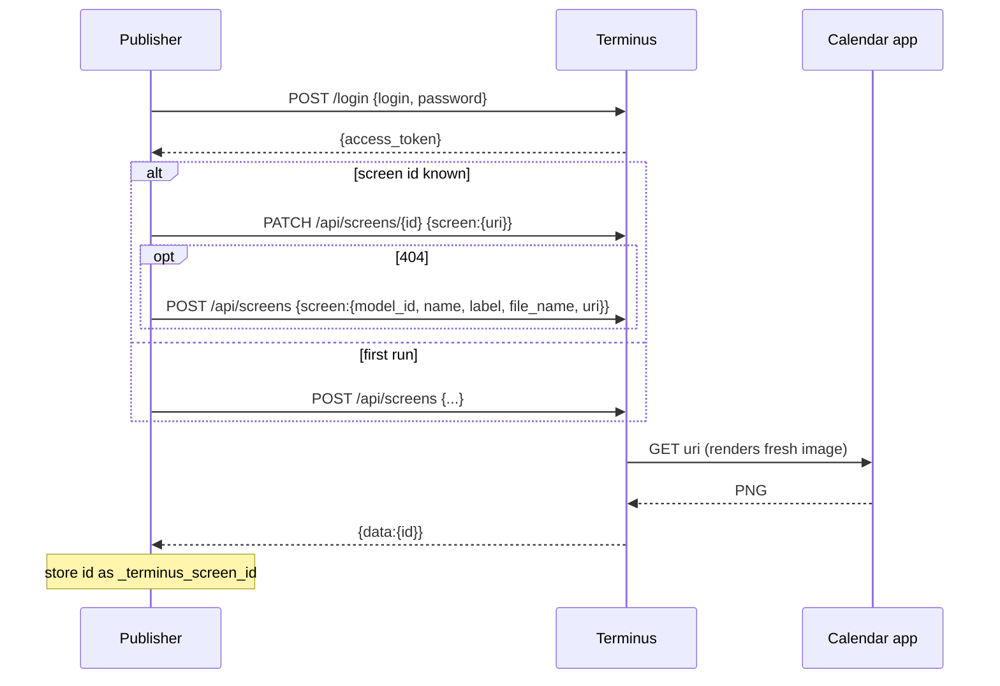

# 05 - Terminus integration

**Updated 2026-10-24.** The spike in `14-terminus-spike-log.md` ran against the owner's real
Terminus and resolved T-1 to T-6, T-8 (mostly) and T-9. Rows below show the result and the
confidence after verification.

## What is known

| Fact | Source | Confidence |
|------|--------|------------|
| Terminus is TRMNL's flagship BYOS server (Ruby/Hanami, PostgreSQL, Valkey, Sidekiq, ImageMagick). | Terminus README | High |
| It is **beta**; upgrades may need manual effort. | Terminus README | High |
| Firmware 1.6.10+ requires Terminus 0.42.0+; older firmware needs older Terminus. | Terminus README | High |
| `quick.sh` is for exploring only (not repeatable); use the Docker docs for a permanent install. | Terminus README | High |
| A **Screens API** creates and updates screens: `POST /api/screens`, `PATCH /api/screens/<id>`; both return HTTP 200 with `{data:{id,...,uri}}`. | `doc/api.adoc`; spike | **High (verified)** |
| A screen can be created from an image **URI**. The image is either *unprocessed* (Terminus converts it for the device) or *preprocessed* (cached as-is). | `doc/api.adoc` | Medium-high |
| The URI is fetched **during the API call, synchronously**, from Terminus's container. No timed re-fetch exists. | spike | **High (verified)** |
| `POST /login` with login and password returns an `access_token` (JWT, about 30 minutes) and a refresh token (about 14 days). `POST /api/jwt` refreshes. | `doc/api.adoc`; spike | **High (login, refresh verified)** |
| The token is placed directly in the `Authorization` header (bare). | spike | **High (verified)**; `Bearer` untested |
| **Extensions** run on a schedule (none by default), run as Sidekiq jobs, and turn polled data into a screen with a **Liquid** template. | `doc/extensions.adoc` | Medium |
| Device refresh rate is 900 s on the owner's device; no sleep window is set. | device page, API | **High (verified)** |
| `preprocessed: true` stores the PNG byte-for-byte; unprocessed mode hard-thresholds to 1-bit. | spike | **High (verified)** |

## Unknowns and spike results

| # | Unknown | Result (2026-10-24) |
|---|---------|---------------------|
| T-1 | Request/response bodies of screens API | **Resolved.** See `14`. HTTP 200 on POST and PATCH; `model_id` string accepted. |
| T-2 | Port and scheme | **Resolved.** `http://<server-ip>:2300`. `/up` needs login for JSON requests. |
| T-3 | Authorization header format | **Resolved.** Bare token. |
| T-4 | `model_id` and bit depth | **Resolved.** id 12, `og_plus`, 2-bit, 800x480. 1-bit OG is id 2 (`og_png`). Resolve by name at run time. |
| T-5 | Unprocessed conversion of a 1-bit PNG | **Resolved, and moot.** Use `preprocessed: true`; the image is stored unchanged. Unprocessed mode thresholds to 1-bit. |
| T-6 | LAN image URL allowed? | **Resolved.** Yes; fetched by Terminus's container during the call. |
| T-7 | Extension polling a LAN URL | **Not tested.** Not needed for option A. |
| T-8 | PATCH and playlists | **Partly resolved.** PATCH is synchronous and keeps the screen id. Playlist membership and device behaviour still to test (S-1, S-2 in `14`). |
| T-9 | Login limits | **Resolved enough.** Two logins fine; tokens independent; refresh works. |

## Options compared

| | A. Push image (prototype) | B. Terminus extension polls JSON | C. Device talks to the app directly |
|---|---|---|---|
| Idea | App PATCHes a Terminus screen with the image URL. | Terminus polls `/api/upcoming` on a schedule; a Liquid template draws the screen. | Implement the BYOS device protocol in the app and skip Terminus. |
| Who draws | The app (Pillow). | Terminus (Liquid + headless browser). | The app. |
| Who schedules | The app (debounce + timer). | Terminus. | The device. |
| Reuses existing renderer | Yes | No, layouts rebuilt in Liquid/HTML | Yes |
| Coupling to Terminus | Screens API + auth | Extension format | Device protocol only |
| Extra moving part | Publisher worker | None | Protocol implementation |
| Main risk | API drift; auth handling; single-process constraint | Layout expressiveness; sections in Liquid | Not what the user asked for; protocol unknown to us |
| Status | **Verified by spike** (device display test pending) | Not started; not needed | Not started |

**Recommendation: A**, now supported by evidence (see `14` and ADR-0003, awaiting owner sign-off).
Option B stays documented but is not needed. Option C was never a goal.

## Push sequence (option A)

Prototype configuration (environment variables; none are stored in the database):

| Variable | Purpose |
|----------|---------|
| `TERMINUS_URL` | Base address of Terminus. |
| `TERMINUS_LOGIN`, `TERMINUS_PASSWORD` | Credentials. |
| `TERMINUS_IMAGE_URL` | Address of `/calendar.png` **as seen from Terminus**. |
| `TERMINUS_MODEL_NAME` (replaces `TERMINUS_MODEL_ID`) | Model name such as `og_plus`; the app looks up the id via `GET /api/models`. |
| `TERMINUS_PLAYLIST_ID` | Optional; adds the screen to a playlist on create. |
| `TERMINUS_SCREEN_NAME` | Default `calendar`. |
| `TERMINUS_PREPROCESSED` | **Default true**; the app renders the model's exact depth. |
| `TERMINUS_VERIFY_TLS` | Default true. |
| `TERMINUS_PUSH_INTERVAL` | Seconds between scheduled pushes, minimum 60, default 900. |

## Error handling to design

- Terminus unreachable or login fails: record status, keep retrying on the next trigger;
  never block saving an event.
- Screen deleted in Terminus (404): recreate once, store the new id.
- Token expiry: logging in on every push works (about 0.24 s). Better: cache the access token
  for about 25 minutes and refresh through `POST /api/jwt` (verified).
- Upload growth: every PATCH writes a new upload file, but the replaced one is removed (S-3 in
  `14`, inferred). Still watch the uploads volume size after the app goes live.
- Image fetch by Terminus fails (app unreachable from Terminus, wrong URL): surface Terminus's
  error text in the UI.

## Future: option B outline

If chosen, the project gains a `plugin/` component: a Terminus extension definition (poll
`/api/upcoming`, schedule, Liquid template per layout) plus documentation of how to install
it. Layout modules would then exist twice (Pillow and Liquid) unless the Pillow path is
dropped. See `plugin/README.md`.
