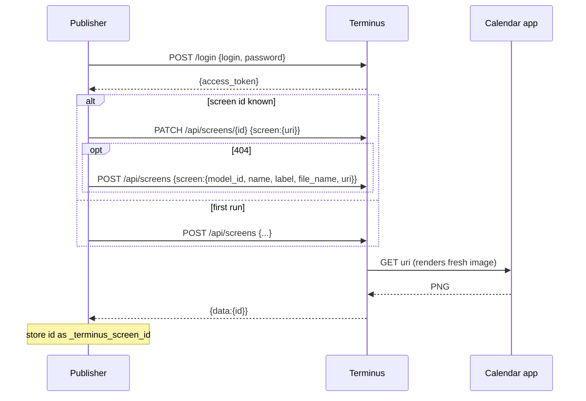

# 05 - Terminus integration

**Read this with the references open.** Several details below are marked *unverified*: they
came from reading documentation, not from running Terminus.

## What is known

| Fact | Source | Confidence |
|------|--------|------------|
| Terminus is TRMNL's flagship BYOS server (Ruby/Hanami, PostgreSQL, Valkey, Sidekiq, ImageMagick). | Terminus README | High |
| It is **beta**; upgrades may need manual effort. | Terminus README | High |
| Firmware 1.6.10+ requires Terminus 0.42.0+; older firmware needs older Terminus. | Terminus README | High |
| `quick.sh` is for exploring only (not repeatable); use the Docker docs for a permanent install. | Terminus README | High |
| A **Screens API** creates and updates screens: `POST /api/screens`, `PATCH /api/screens/<id>`. | `doc/api.adoc` | Medium-high |
| A screen can be created from an image **URI**. The image is either *unprocessed* (Terminus converts it for the device) or *preprocessed* (cached as-is). | `doc/api.adoc` | Medium-high |
| The URI is fetched **at the time of the API call**. No timed re-fetch of an image was found in the docs. | `doc/api.adoc`, absence of evidence | Medium |
| `POST /login` with login and password returns an `access_token` (JWT, about 30 minutes) and a refresh token (about 14 days). | `doc/api.adoc` | Medium |
| The docs show the token placed directly in the `Authorization` header. | `doc/api.adoc` | Medium; whether `Bearer ` is accepted is unknown |
| **Extensions** run on a schedule (none by default), run as Sidekiq jobs, and turn polled data into a screen with a **Liquid** template. | `doc/extensions.adoc` | Medium |
| Device refresh-rate example in the docs is 900 s. | Terminus docs | Low-medium |

## What is not known (verify first)

| # | Unknown | How to verify |
|---|---------|---------------|
| T-1 | Exact request/response bodies of `POST/PATCH /api/screens` (field names, `model_id` type and values, `playlist_id`). | Read `doc/api.adoc` again in full; try against a local Terminus. |
| T-2 | Terminus HTTP port and scheme for a Docker install (the prototype's examples guessed `:2300`). | Terminus Docker docs. |
| T-3 | `Authorization` header format: bare token or `Bearer`. The prototype tries bare first, then `Bearer`. | Test. |
| T-4 | Correct `model_id` for the user's device, and its bit depth (OG 1-bit vs 2-bit). | Terminus UI model list; device docs. |
| T-5 | How "unprocessed" conversion treats a pure 1-bit black/white PNG (threshold, dither, resample). | Push a test image, inspect Terminus's stored result. |
| T-6 | Whether Terminus will fetch an image from a **private LAN address** (any SSRF-style restriction). | Test. |
| T-7 | Whether an extension's polling can target a private LAN JSON URL. | `doc/extensions.adoc`; test. |
| T-8 | Whether `PATCH` keeps the screen in the existing playlist and device rotation. | Test. |
| T-9 | Rate limits or auth lockouts on `/login` if the app logs in on every push. | Docs; test. |

## Options compared

| | A. Push image (prototype) | B. Terminus extension polls JSON | C. Device talks to the app directly |
|---|---|---|---|
| Idea | App PATCHes a Terminus screen with the image URL. | Terminus polls `/api/upcoming` on a schedule; a Liquid template draws the screen. | Implement the BYOS device protocol in the app and skip Terminus. |
| Who draws | The app (Pillow). | Terminus (Liquid + headless browser). | The app. |
| Who schedules | The app (debounce + timer). | Terminus. | The device. |
| Reuses existing renderer | Yes | No, layouts rebuilt in Liquid/HTML | Yes |
| Coupling to Terminus | Screens API + auth | Extension format | Device protocol only |
| Extra moving part | Publisher worker | None | Protocol implementation |
| Main risk | API drift; auth handling; single-process constraint | Layout expressiveness; sections in Liquid | Not what the user asked for; protocol unknown to us |
| Status | Code written, **untested** | Not started | Not started |

Recommendation so far: **A**, pending T-1 to T-6. Option B is the fallback if pushing proves
brittle. Option C was never discussed with the user as a goal. (ADR-0003)

## Push sequence (option A)

Prototype configuration (environment variables; none are stored in the database):

| Variable | Purpose |
|----------|---------|
| `TERMINUS_URL` | Base address of Terminus. |
| `TERMINUS_LOGIN`, `TERMINUS_PASSWORD` | Credentials. |
| `TERMINUS_IMAGE_URL` | Address of `/calendar.png` **as seen from Terminus**. |
| `TERMINUS_MODEL_ID` | Needed only to create the screen. |
| `TERMINUS_PLAYLIST_ID` | Optional; adds the screen to a playlist on create. |
| `TERMINUS_SCREEN_NAME` | Default `calendar`. |
| `TERMINUS_PREPROCESSED` | Default false (let Terminus convert). |
| `TERMINUS_VERIFY_TLS` | Default true. |
| `TERMINUS_PUSH_INTERVAL` | Seconds between scheduled pushes, minimum 60, default 900. |

## Error handling to design

- Terminus unreachable or login fails: record status, keep retrying on the next trigger;
  never block saving an event.
- Screen deleted in Terminus (404): recreate once, store the new id.
- Token expiry: current design logs in on every push (simple, wasteful). Alternative: cache the
  token and use the refresh token. Needs T-9.
- Image fetch by Terminus fails (app unreachable from Terminus, wrong URL): surface Terminus's
  error text in the UI.

## Future: option B outline

If chosen, the project gains a `plugin/` component: a Terminus extension definition (poll
`/api/upcoming`, schedule, Liquid template per layout) plus documentation of how to install
it. Layout modules would then exist twice (Pillow and Liquid) unless the Pillow path is
dropped. See `plugin/README.md`.
