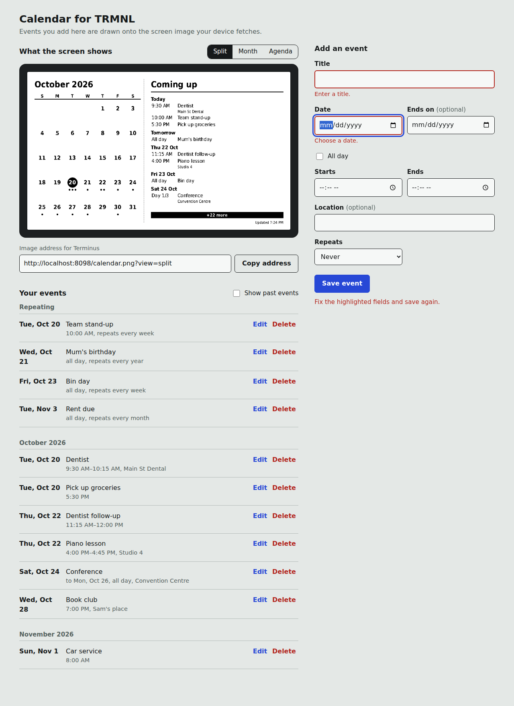

# 07 - Editor UI design

> **Partly superseded (2026-10-27).** The target layout below predates the phone-first manage area, people,
> undo, saved views and the live native-size preview (`15`, `17`). It is rewritten at the start of the slice
> that builds the UI (`10-roadmap.md`).
>
> **Built in slice 3:** the Views page and the view editor. On a desktop the settings sit left and the
> native-size preview right; on a phone two tabs (Settings, Preview). The preview refreshes about 300 ms
> after each change (`POST /api/v1/views/preview`); without JavaScript an **Update preview** button does
> the same. The fit check sits under the preview. Leaving with unsaved changes asks first.

Single page, no framework, server-rendered shell plus a small script. Built in v1; the
screenshots show **v1 only** (no section or layout controls yet).



## Information architecture (target)

```
+------------------------------------------------------+------------------------+
| Calendar for TRMNL                                   |                        |
+------------------------------------------------------+  Add / edit an event   |
| What the screen shows                                |  - Title               |
|  [ device-framed live preview of /calendar.png ]     |  - Section  (select)   |
|  Image address [ http://host:8080/calendar.png ][Copy]  - Date / Ends on      |
|  Terminus: connected, last push 2:05 PM [Push now]   |  - All day / Start/End |
+------------------------------------------------------+  - Location            |
| Screen layout                                        |  - Repeats / Until     |
|  View [Month v]  Week starts [Sun v]  Time [12h v]   |  [Save event]          |
|  [x] Weekends  [x] Section labels  [ ] Hide empty    |                        |
+------------------------------------------------------+  (sticky on desktop)   |
| Sections                                             |                        |
|  Events  height[1] [x]show  up down  Delete          |                        |
|  Work    height[1] [x]show  up down  Delete          |                        |
|  [ new section name ] [Add section]                  |                        |
+------------------------------------------------------+                        |
| Your events (grouped: Repeating, then by month)      |                        |
+------------------------------------------------------+------------------------+
```

Behaviours:
- Layout settings and section edits **autosave on change**, announce the result in an
  `aria-live` region, then refresh the preview and trigger a push.
- The preview always shows what the device will get with no `?view=` (the saved layout).
- The image address field shows the URL **as the browser sees it**; the value Terminus needs
  may differ (see `02-architecture.md`, deployment).

## Principles used in v1

- The one memorable element is the e-paper preview inside a device-style bezel.
- Cool grey page, near-black ink, one blue accent used only for primary actions and focus.
- Ruled rows rather than cards. One corner radius family.
- System-font stack with a legible fallback (no web fonts, so it works offline on a LAN).
- Visible focus rings, labelled controls, errors shown beside fields, table-like data uses
  tabular numbers.
- Event titles are inserted with `textContent` so a title can never inject HTML.

## Open UI questions

- Do sections need colours or icons, or does the 1-bit output make position enough? (OQ-6)
- Is autosave right for the sections manager, or should edits be explicit?
- Is a separate "layout preview" per view needed before saving?
- Mobile: the v1 layout stacks the form above the preview; confirm that is the right order.

## Month page (web only)

`GET /month?y=&m=&day=&person=` shows one month as a grid of whole weeks (starting on the calendar's
week start). The home page has a **List | Month** switch. Each day cell has the day number (selects the
day), a **+** link that opens the add form on that date, up to three events (category symbol, time,
title) and "+N more". Trips appear on every day they cover with ◂/▸ markers. The person chips filter
like the list page; events with no people always show.

On a phone (<640 px) cells show only a count; tapping the day number opens a list for that day below
the grid with an "Add event on this day" button. Everything is plain links, so it works without JS.

The forms opened from here carry a `back` field (same-site paths only, via `safe_next`), so saving,
deleting or cancelling returns to the same month. There is deliberately no month layout for the e-ink
screen: it would be too cramped at 800x480.

## Drafts, icon and export (slice 5)

- **Drafts.** The add/edit event form keeps what you type in the browser's local storage on that device
  only (nothing is sent to the server). Reopen the form after a failed save, a lost connection or a
  closed tab and a bar offers **Restore** or **Discard**. A draft is dropped once a save succeeds (the
  next normal page you reach clears submitted drafts) and after 7 days. If the browser blocks storage,
  the form works as before.
- **Home-screen icon.** `static/manifest.webmanifest`, 180/192/512 px icons and an Apple touch icon,
  so "Add to Home Screen" gives a calendar icon and opens full-screen.
- **Export.** Settings has "Download all my data": `GET /api/v1/export` returns every table the owner
  edits (calendar, categories, people, events, repeats' skipped dates, display, views) as JSON. Push state,
  idempotency keys and app_meta are left out. Import is not built.

## Phone pass (slice 5)

Checked at 390 px wide in dark mode (home, month, add/edit event, categories, people, views, holidays;
none scroll sideways). Fixed: "Add event" no longer wraps onto two lines in the page header (headers wrap
instead); weekday checkboxes and "Ends" options sit close together instead of 60 px apart (a CSS
specificity bug); the view list no longer repeats a layout name that equals the view's name, and its
buttons wrap below the name when space is tight.

## Edit conflicts (slice 5)

If someone saved an event after you opened it, your save is **not** applied and your typing is **not**
thrown away. The form comes back with your values, a warning saying who changed it and when, and a list
of the fields that now differ ("Title: saved now ‘Dentist 2’, yours ‘Orthodontist’"). The form carries the
newer `rev`, so pressing **Save changes** knowingly replaces their version; "discard yours and see theirs"
reloads the saved event. Deleting a changed event is still refused with a message. The JSON API is
unchanged (409 with `current_rev`).

## Work schedule (rotating weeks)

For a repeating shift pattern such as "week A: Mon Tue Fri Sat Sun, week B: Wed Thu". In Add event,
**Repeats → Rotating weeks (work schedule)...** shows two rows of weekday boxes. The **Day** field decides
which week is week A (the week containing that day; weeks run Monday to Sunday). Everything else
(category, people, times, end date or count) is the same as any event, and it is one event, so it
shows on the screen and the month page like any other.

Each day can be set to **Out** (away from home, for example at the clinic), **In**, or left undecided
(plain title) with one tap, without opening the event: the buttons appear under a schedule's days on the
home list and in the month page's selected-day panel. Tapping the active button clears it. **Day off**
skips that day. The edit page's "Days off" box skips a single date or, with "Through", a whole stretch
(vacation, sick days). An extra shift is an ordinary one-off event. A new schedule from a given date:
end the old one with "ends on a date" and add the new one.

## Badges on Two weeks - list

Two weeks - list now has the **Show who it is for (initials)** option, on by default, same boxes as
Week - lanes (all white; up to three, main person first). The boxes sit at the
right of an item's first line, so long titles wrap onto the next line rather than being cut; a time
followed by a long first word may wrap to a second line. Existing views pick the option up as "on".
Both layouts draw the boxes through one shared module, `render/layouts/badges.py`.
