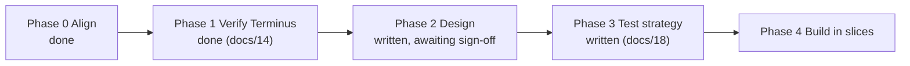

# 10 - Roadmap (design first, then vertical slices)

Status 2026-10-27: phases 0 to 3 are written and the owner signed off the design on 2026-10-27.
Slice 0 may start once the gate checklist below is clear.

| Phase | Output | State |
|-------|--------|-------|
| 0 Align | Blocking questions answered (`08`, `15`) | Done |
| 1 Verify | Spike log; `05` updated; ADR-0003 accepted with review gate E-1 | Done |
| 2 Design | `02`, `03`, `04`, `06`, `app/README.md`, ADRs 0003 to 0010 | Signed off 2026-10-27 |
| 3 Test strategy | `18` | Written |
| 4 Build | Slices below | Slice 0 done (2026-10-27); slice 1 in review |

## Slices (each demoable; each ends with a trial on the real panel or phone)

| Slice | Content | Demo (done when) | Needs Terminus |
|-------|---------|------------------|----------------|
| 0 Foundations | `app/` skeleton, Dockerfile with bundled fonts, `/healthz`, migration runner and baseline, CI (stage 1 of ADR-0008), `deploy/compose.yml`, backup job | Container builds in CI, runs on the server, `/healthz` is green, a backup file appears | No |
| 1 Events and the first image | Event create, edit, delete with undo (soft delete), recurrence (daily to yearly, every N, weekdays, nth weekday, skips), trips; the 2-bit PNG encoder; the **Week - lanes** layout; `/render/<hash>.png`; a plain page to add events | Add a repeating event and a trip; the week image matches the approved mock-up | No |
| 2 Categories and people | Category manager (lanes and banner), people with labels and owner, "who am I", filters | Create "Outings", mark an owner, see badges (built; also settings, filters, zoomable preview) | No |
| 3 Views and the editor | Views table, templates, **Two weeks - list**, live native-size preview, fit check, active view | Build a Work-days view and watch the preview; wife builds one (built; waiting for owner trial) | No |
| 4 Push | Terminus client (login cache, models by name, create or PATCH, 404 recovery), scheduler (debounce, 15-minute check, push only on change), status panel, "Push now", fake-Terminus contract tests; bulk holiday import (pick a region such as Canada / Nova Scotia and years, tick the holidays, added as editable events in a Holidays banner category, no duplicates on re-run) | Edit an event on a phone; the panel changes within one check-in (built; needs the on-device trial) | **Yes** |
| 4b Experiment E-1 | Stable `/calendar.png`; trial a Terminus poll extension against push; measures M1 to M5 | Results in ADR-0003; owner picks push, pull or both | Yes |
| 5 Polish and operate | Mobile-first manage UI pass, glance view, home-screen icon, drafts and conflict warnings, export, backup restore drill, Beszel alert, optional shared password | The wife's trial passes; restore drill passes | Yes |

Ordering rationale: slices 0 to 3 need no Terminus and can be tested fully off the device; slice 4 depends on
the verified spike. The UI is built a little in each slice; slice 5 hardens it. Later candidates: more layouts
as templates (Day rows, Agenda, Two weeks - lanes, Overview, Month), ICS import, "this and following" edits,
several displays, **more holiday regions** (see below).

**Owner additions 2026-10-29:** a work schedule as rotating weeks with per-day in/out and days off,
instead of ICS import for her shifts.

**Owner additions 2026-10-28 (built between slices 4 and 5):** a repeat count ("repeat N times"), the
screen's refresh interval read from Terminus instead of hard-coded, and a web-only month page with
click-to-add (not an e-ink layout: too cramped at 800x480).

**Owner request 2026-10-28, later phase: add more holiday regions.** The holiday import works well for
Nova Scotia. Regions are rules in `domain/holidays.py` (`REGIONS`), so adding one is a code change, not a
settings screen. Candidates: other Canadian provinces and the federal list, and other countries when
the owner names them. Each region needs its dates checked against the official source and tests for two
years, as Nova Scotia has. Whether a region can be added from the UI instead (owner types names and
date rules) is left open; the code route is simplest and keeps the rules testable.

**Owner decision 2026-10-28:** the slice plan above stays as it is. ICS import is a **later phase, after
slice 5**, and its real-data testing waits until then. Notes for when it is picked up:

- One-time, file-based import of a Google Calendar `.ics` export; **no ongoing sync**, and her personal
  calendar is not mirrored (she keeps her work schedule in a personal Google calendar; the owner keeps the
  shared paper calendar's days in this app).
- Pick-and-choose, nothing saved until confirmed: preview with date range (default next 6 months), text
  search, per-event tick boxes, target category; re-import is safe (events keep their Google UID).
- Unsupported items (a changed single occurrence, unsupported repeat rules) are listed with the reason, never
  dropped silently. Times convert to the calendar's local time (ADR-0010).
- Open questions for then: are her shifts all-day or timed, single or repeating; whether a trimmed sample export
  is available (kept out of the public repo; tests use made-up fixtures).
- Needs slice 2 (categories, people) to exist; write an ADR when it starts.

## Gate checklist before slice 0

1. ~~Owner signs off ADRs 0003 to 0010~~ Done 2026-10-27.
2. ~~Server disk enlarged (`13`, P-7)~~ Done (20 GB). ~~DHCP leases set (P-1)~~ Done (2026-10-28).
3. Branch protection and secret scanning on in `homelab` (`12`); decision on what in `13` and `spikes/` stays
   public.
4. Open items RD-3 and RD-4 (`04`) get a short on-device test inside slice 1.
