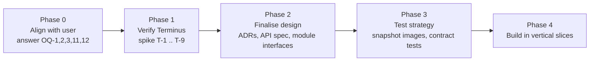

# 10 - Suggested roadmap (design first)

No production code until phases 0 and 1 are agreed.

| Phase | Output | Done when |
|-------|--------|-----------|
| 0 Align | Answers to blocking questions recorded in `08`. | User confirms device, Terminus setup, stack, option A vs B. |
| 1 Verify | A short spike log (curl transcripts or a throwaway script) updating `05` rows to High confidence. | T-1 to T-6 resolved with evidence. |
| 2 Design | ADRs accepted; `02`, `03`, `04`, `06` revised; folder structure confirmed in `app/README.md`. | User signs off. |
| 3 Test strategy | Written plan: fixture dataset, fixed-`now` image snapshots, recurrence unit tests, a fake Terminus for contract tests. | Plan reviewed. |
| 4 Build | Vertical slices, each demoable: (1) events + image, (2) sections + layouts, (3) settings, (4) push, (5) polish. | Per-slice acceptance in `01`. |

Suggested slice order rationale: slices 1-3 need no Terminus; slice 4 depends on phase 1.
