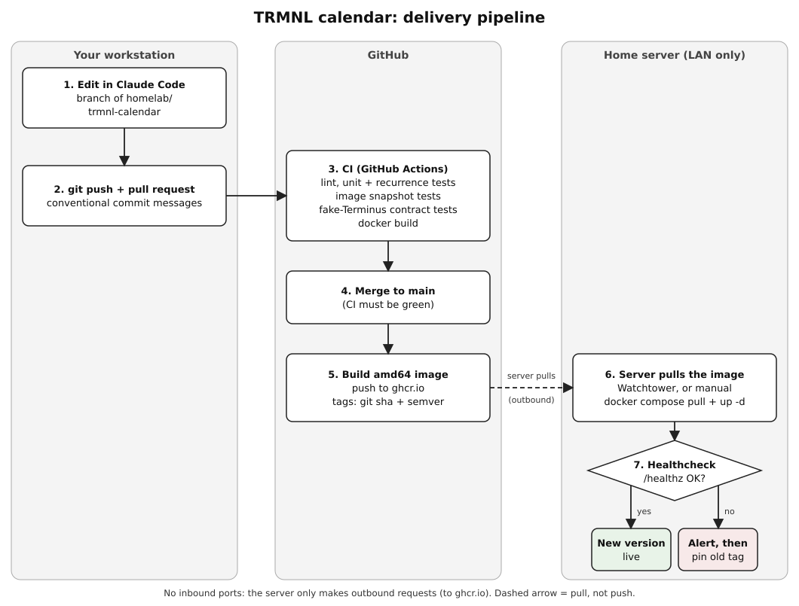
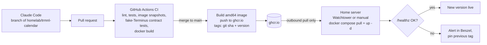

# 12 - Delivery pipeline (code to running server)

Status: **Proposed, revised 2026-10-25.** Direction from the owner: develop with Claude Code,
then update the server with a `docker pull`. Facts used: server is x86_64 (D-1), the `homelab`
repo is **public** (D-2), no other service is deployed from GitHub yet (D-3), Watchtower already
runs on the server. Recorded as ADR-0008.

PNG copy: [`assets/delivery-pipeline.png`](assets/delivery-pipeline.png).

## Flow in words

1. Work happens in Claude Code on a local clone of `homelab`, on a branch.
2. Push the branch and open a pull request (conventional commit messages).
3. GitHub Actions runs on the PR: lint, unit and recurrence tests, fixed-time image snapshot
   tests, contract tests against a fake Terminus, and a `docker build`.
4. Merging to `main` is allowed only when CI is green.
5. On merge, Actions builds an **amd64** image and pushes it to `ghcr.io`, tagged with the git
   SHA and a version.
6. The server pulls the new image (Watchtower, or a manual `docker compose pull && up -d`).
   The server only makes **outbound** requests; no inbound ports.
7. The container healthcheck (`/healthz`) and Beszel show whether the new version is healthy.
   Rolling back means pinning the previous tag. (Watchtower's own rollback support is not
   verified, so we do not rely on it.)

## Rollout in stages (recommended for a first CI/CD setup)

| Stage | What | Why |
|-------|------|-----|
| 1. CI only | Tests and a Docker build run on every PR. Deploy by hand: `docker compose pull && docker compose up -d` on the server. | Learn the loop with the lowest risk. Fastest iteration while the app is changing daily. |
| 2. Image registry | On merge to `main`, publish to GHCR. The server pulls by hand or on a short cron. | Reproducible, versioned images. |
| 3. Auto-update | Add the Watchtower label to the calendar container. Terminus keeps its own pinned policy (`13`, P-3). | Hands-off once the app is stable. Note: Watchtower runs once a day (04:00 UTC) unless changed. |
| 4. Hardening | Healthcheck alerts in Beszel, backups of the data volume, optional release tags. | Operations. |

Decision D-4 (auto-deploy on merge, or approve first) is answered by choosing the stage.

## Public-repo practices (the repo is public)

| Practice | How |
|----------|-----|
| Never commit secrets | `.gitignore` covers `.env`, `*.db`, `data/`. Commit `.env.example` with names only. Server secrets stay in a `chmod 600` file on the server. |
| Turn on GitHub's free protections | Secret scanning with push protection, Dependabot alerts and version updates, branch protection on `main` (require a PR and the CI check), and two-factor authentication on the account. The account is the deploy key: whoever controls it controls what the server pulls. |
| No self-hosted runner | The repo is public, so use only GitHub-hosted runners. Never run untrusted pull-request code on the home network. |
| Safe workflows | Trigger CI on `pull_request`, not `pull_request_target`. Declare minimal `permissions:` per workflow. Pin third-party actions to a commit SHA. Use only the built-in `GITHUB_TOKEN`. |
| Image visibility | Images hold no secrets, so a public GHCR package is simplest (no registry login on the server). Check the package's visibility setting in GitHub after the first publish. |
| Mind what the docs reveal | Design docs may be public. Raw infrastructure detail (IPs, hostnames, known weak settings such as root SSH, raw logs) is better kept out of the public repo or generalised. See "What not to publish". |
| Workflow location | GitHub reads workflows only from the repo-root `.github/workflows/`, with `paths: trmnl-calendar/**` filters. |
| Line endings | `.gitattributes` forces LF so shell scripts work on Linux. |

## What not to publish

`docs/13-infrastructure.md` and `docs/spikes/` describe the home network (private IPs,
hostnames, the root-SSH setting, container internals). Private addresses are low risk, but
publishing a known weakness before it is fixed is avoidable. Options, in order of preference:
fix P-8 (SSH) first, then keep the files but replace addresses with placeholders such as
`<server-ip>`; or move `13` and `spikes/` into a private repository. Never publish MAC
addresses, API keys, tokens or `.env` contents (none are in the docs today).

## Principles

| Principle | How |
|-----------|-----|
| No internet exposure | Pull-based deploy; the server never accepts connections from GitHub. |
| Few moving parts | One image, one compose project, reuse the existing Watchtower. |
| Reproducible | Base images and GitHub Actions pinned by digest or SHA; Terminus pinned. |
| Data is never lost | App backs up SQLite before a migration; nightly backup copy kept off the container. |
| Automated upkeep | Dependabot PRs for packages, base images and Actions. Terminus upgrades must pass the contract tests. |
| Monorepo friendly | Workflows filtered to `trmnl-calendar/**`; image tags namespaced. |

## Alternatives considered

| Option | Verdict |
|--------|---------|
| Push over SSH from Actions | Needs an inbound path or a VPN. Rejected. |
| Self-hosted Actions runner on the server | Not acceptable for a public repo. |
| Own deploy timer script | Not needed now that Watchtower exists. Revisit if we need health-checked rollback. |
| Server builds from source | Builds on a small machine, less reproducible. |

## Repository bootstrap

Status: done. The design repo was imported to `homelab/trmnl-calendar`. Dotfiles
(`.gitignore`, `.dockerignore`) did not survive the upload and were re-added afterwards.

## Open items

| ID | Question | Status |
|----|----------|--------|
| D-1 | Server architecture | **Answered:** x86_64, Ubuntu 24.04 container, Docker present |
| D-2 | Repo public or private | **Answered:** public |
| D-3 | How other services deploy | **Answered:** none from GitHub; plain Compose under `/root` |
| D-4 | Auto-deploy or approve first | **Answered 2026-10-25:** stage 1 (CI only, manual pull and update). Stages 2 to 4 later. |

## Diagram source (Mermaid, for editing)

