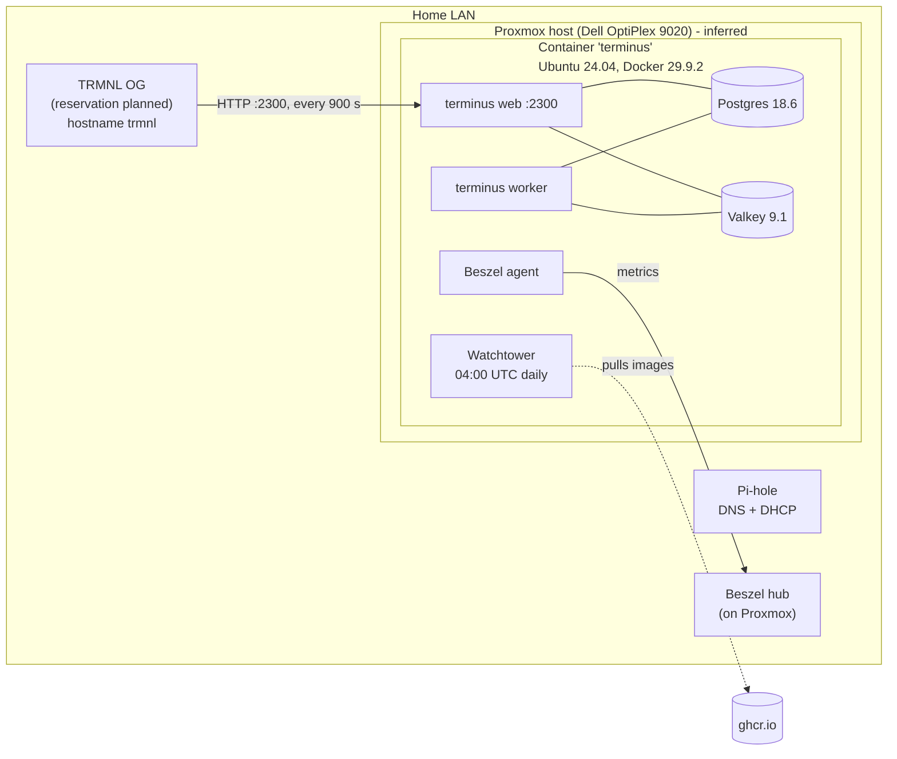

# 13 - Infrastructure inventory and runbook

Status: **Draft.** Facts come from `collect-infra.sh` and follow-up commands run on
2026-10-24, plus the Terminus device page. Each fact is **Verified** (seen in output),
**Inferred** (reasoned from output) or **Pending** (not yet collected). Nothing in
"Proposed changes" has been applied yet.

Do not commit raw collector output, MAC addresses, API keys or `.env` files to this repo.

## Topology

## Hosts and devices

| Item | Value | Confidence |
|------|-------|------------|
| Monitoring | Beszel hub (on Proxmox) with an agent on this host; used to check services are up | Owner-stated / Verified (agent) |
| Terminus host | Container `terminus`, Ubuntu 24.04.5, x86_64, 2 GiB RAM, 9.8 GB root disk (5.9 GB used) | Verified |
| Runs on | Proxmox LXC on a Dell OptiPlex 9020 (i5-4570). Owner confirms a 2-node Proxmox cluster hosts the services; further Proxmox details are out of scope | Owner-confirmed (cluster); Inferred (this is an LXC) |
| Host IP | <server-ip>, DHCP lease. **No reservation confirmed** | Verified / Pending |
| DNS and DHCP | Pi-hole at <dns-ip> serves both (owner). DHCP reservations are therefore made in Pi-hole, not the router | Owner-stated |
| Timezone | America/Halifax, clock synced | Verified |
| Remote access | Privileged account over SSH; hardening planned (P-8) | Verified |
| Firewall | ufw not active (Docker bypasses ufw for published ports anyway) | Verified |
| Docker | Engine 29.9.2, Compose 5.6.1, root dir `/var/lib/docker` | Verified |
| Terminus base URL | `http://<server-ip>:2300` (plain HTTP; nothing on 2443). `/up` returns 401 for JSON requests, so it is not an anonymous health check | Verified |
| Terminus version | UI shows "Latest (ahead of 0.78.0)": a rolling build, not a tagged release. Image revision `561eb00d`, built 2026-10-22; digest `sha256:5c96afbac7de...` | Verified |
| Device | TRMNL OG, Terminus model `og_plus` (id 12, "TRMNL OG (2-bit)"), 800x480, firmware 1.8.6, 2.4 GHz Wi-Fi | Verified |
| Device settings | **Display Compatibility switched on (owner, 2026-10-25)**; refresh rate 900 s, playlist id 7 ("Device 7", one screen), no sleep window. Empty leftover playlists 5 and 6 exist | Verified |
| Device network | <device-ip> and hostname `trmnl` planned as a DHCP reservation | Planned |
| Proxmox details | Version, container ID, rootfs size, memory limit, backup jobs | Pending |

Design consequences: the display is 800x480 (matches the prototype) and the model is **2-bit
(4 grey levels)**. The spike showed Terminus stores a preprocessed 2-bit or 1-bit PNG exactly
as sent (see `14`). A 900 s refresh means a change can take up to 15 minutes to appear on the
display after we push it.

## Containers

| Container | Image | Published port | Notes |
|-----------|-------|----------------|-------|
| terminus-web-1 | `ghcr.io/usetrmnl/terminus:latest` | 2300 | healthy; Watchtower label on |
| terminus-worker-1 | same image | none | healthy; Watchtower label on |
| terminus-database-1 | `postgres:18.6-alpine` | **5432 on all interfaces** | user and db `terminus`; no Watchtower label |
| terminus-keyvalue-1 | `valkey/valkey:9.1-alpine` | **6379 on all interfaces** | password set; Watchtower label on |
| terminus-init-certificates-1 | Terminus image (old build) | none | one-shot, exited 0 (normal) |
| watchtower | `nickfedor/watchtower:latest` (1.23.2) | none | label opt-in, no notifications |
| beszel-agent | `henrygd/beszel-agent` | host network | monitoring agent; hub location pending |

Compose projects: `/root/terminus/compose.yml` (upstream git clone, 27 commits past tag
0.78.0, one local edit), `/root/watchtower/compose.yml`, `/root/compose.yml` (Beszel).
The only local edit to upstream's compose file is three added Watchtower labels (web, worker,
keyvalue).

Volumes (85 MB total): `terminus_database-data`, `terminus_keyvalue-data`,
`terminus_web-uploads`, `terminus_web-fonts`, `terminus_certificates`.

## What must survive a rebuild

| Asset | Where | Why it matters |
|-------|-------|----------------|
| Postgres data | volume `terminus_database-data` | devices, playlists, screens, users |
| Uploads | volume `terminus_web-uploads` | screen images, including ones we push |
| `.env` | `/root/terminus/.env` | keys: HANAMI_PORT, API_URI, APP_SECRET, DATABASE_*, KEYVALUE_* |
| Compose files and overrides | `/root/terminus`, `/root/watchtower`, `/root` | the stack definition |
| Device API key | Terminus device page (secret) | re-registering a device otherwise |

Valkey, fonts and certificates are rebuildable.

## Proposed changes (none applied)

| ID | Change | Why | Priority |
|----|--------|-----|----------|
| P-1 | Pi-hole static DHCP lease for the server (<server-ip>) as well as the device (<device-ip>, `trmnl`) | `API_URI` and the device config use the IP; a changed lease breaks the display | High |
| P-2 | Move local edits into `compose.override.yml`; keep upstream `compose.yml` unmodified | Avoids `git pull` conflicts | Medium |
| P-3 | Pin web and worker by digest; remove their Watchtower label; upgrade deliberately after contract tests | An unattended update replaced Terminus on 2026-10-23; Terminus is beta | High |
| P-4 | Watchtower: set `TZ: America/Halifax`; add a notification target | `TZ` is still the placeholder (runs in UTC); failures are silent | Medium |
| P-5 | Stop publishing 5432 and 6379 after confirming nothing on the LAN uses them | Both are reachable from the LAN with only a password | Medium |
| P-6 | Backups (see below) | None exist inside the container | High |
| P-7 | Enlarge the container root disk (suggest 20 GB or more) | 3.4 GB free; an image update downloads about 2.4 GB first | High |
| P-8 | Create a non-root admin user, use SSH keys, disable password login for privileged accounts | Reduce LAN exposure | Medium |
| P-10 | Optional: Pi-hole local DNS names (for example `calendar.lan`) for browsing. **Use the IP address, not the name, in `PUBLIC_BASE_URL`** (the image URL Terminus fetches), so a Pi-hole outage cannot break pushes | Low |
| P-11 | In Beszel, alert on disk use of this host and watch the calendar container, once deployed | Medium |
| P-9 | Copy the compose files and a secrets-free `.env.example` into `homelab/infra/terminus/` | Rebuild from git | Medium |

## Backup plan (proposed, untested)

- **Nightly logical dump:** `docker compose -f /root/terminus/compose.yml exec -T database pg_dump -U terminus terminus | gzip > <backup dir>/terminus-db-$(date +%F).sql.gz`
- **Uploads and config:** tar the `terminus_web-uploads` volume and copy `.env` and the compose files.
- **Location:** a directory that is not inside the container's own disk (Proxmox storage or another machine). Pending the Proxmox report.
- **Retention:** keep 14 dailies and 8 weeklies.
- **Restore test:** run a restore into a scratch container once before relying on it, and again after each major Postgres or Terminus change.
- **Proxmox level:** if `vzdump` jobs exist for this container, they complement but do not replace the logical dump. Pending.

## Rebuild runbook (draft, untested)

1. Create an Ubuntu 24.04 container on Proxmox with nesting enabled and enough disk (P-7). Set a DHCP reservation (P-1).
2. Install Docker Engine and the Compose plugin from Docker's official instructions.
3. Fetch the stack: `git clone` this repo and use `infra/terminus/` (P-9), or re-clone upstream Terminus at the commit recorded there.
4. Restore `.env` from backup. Do not regenerate `APP_SECRET`.
5. Start the database only, restore the latest dump, then `docker compose up -d`.
6. Restore the uploads volume.
7. Verify: `curl -s -o /dev/null -w '%{http_code}' http://localhost:2300/` returns a redirect (302), then log in to the UI and confirm the device checks in at its next wake. (`/up` is not usable anonymously.)
8. Re-enable Watchtower (labels only on containers meant to auto-update).

## Maintenance

| Task | Frequency | How |
|------|-----------|-----|
| OS security updates | Monthly, or enable unattended upgrades | `apt` inside the container; currently none pending |
| Terminus upgrade | Deliberate, when contract tests pass | Change the pinned digest (P-3), then `docker compose up -d` |
| Postgres minor update | With Terminus upgrades | Bump the tag; take a dump first |
| Backup check | Monthly | Confirm last dump exists and restores |
| Disk check | Monthly | `docker system df`, `df -h /` |

## Pending information

- Proxmox report: version, container ID and config, rootfs size, memory, backup jobs, storage.
- Whether the Pi-hole static leases for server and device are created (P-1).
- Repo visibility (D-2).
