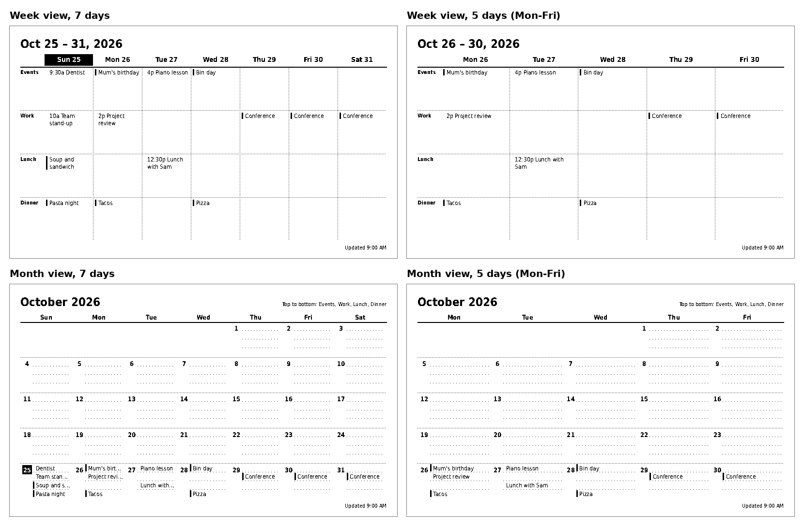

# 15 - Owner requirements: views and the "manage" experience

Status: **Captured 2026-10-25, not yet designed.** These came from the owner in conversation and
are folded into `01`, `03`, `04`, `06` and `07` after the open questions below are answered.

## What the owner asked for

1. Flexibility on which parts of a day to track: appointments, holidays, meals, outings, and so on.
2. Because the screen is small, customisable **views** (day, week, weekend, month, ...) and a
   choice of which fields each view shows. Example: a month view showing only work days, or a
   week view showing everything. The image is rendered for that use-case.
3. A very easy **manage** area, used by two people (the owner and his wife) in a desktop and a
   phone browser. It must be seamless and bulletproof for the wife.
4. Adding an event is: pick the day, choose the category, give minor details (time, description,
   person).

## Requirements

### Views

| ID | Requirement | Covered by existing design? |
|----|-------------|-----------------------------|
| V-1 | User-defined categories for parts of a day (appointments, holidays, meals, outings, ...) | Yes: sections (ADR-0004). The UI says "category". |
| V-2 | Saved **views**: layout (day, week, weekend, two-week, month, agenda), day-of-week filter, category filter, person filter, field toggles | No: new `views` table |
| V-3 | One **active view** per display; switching is one tap | No |
| V-4 | **Fit check**: when a view cannot be drawn legibly (too many categories for the cell size), the preview says so | No: rendering design |
| V-5 | Holidays and similar whole-day items can be drawn as a banner at the top of the day cell instead of a lane | No: `sections.placement` |
| V-6 | (Could) switch the active view on a schedule, for example weekend view on Saturdays | Possible with the 15-minute loop |
| V-7 | (Later) rotate several views on the device | Later; each view would be its own Terminus screen |

### People

| ID | Requirement |
|----|-------------|
| P-1 | A list of people (name and a one or two letter label, for example the owner, his wife, family) |
| P-2 | An event has zero or more people; none means everyone. An event may also have **one owner** among them (a doctor's appointment, a skating lesson). "Person" is who it is for, not who typed it. |
| P-3 | Views can filter by person ("my week") |
| P-4 | On the e-paper image, an event shows its person label |

### Manage experience

| ID | Requirement |
|----|-------------|
| M-1 | **No accounts, but profiles.** On first visit a device asks "Who are you?" once and remembers it. This sets the default person for new events and records who changed what. It is not authentication. |
| M-2 | Phone first, desktop equally good. Large touch targets, one column on a phone. |
| M-3 | Add an event in a few taps: day, category, description, optional time, person. Everything else is hidden under "More". |
| M-4 | Smart defaults: today preselected, last used category remembered, person set from the profile, all day unless a time is entered. |
| M-5 | **Undo, not "are you sure".** Deleting shows an Undo; deleted items stay recoverable for 30 days. |
| M-6 | Never lose typed input: a draft survives a failed save, a dropped Wi-Fi connection or an accidental close. |
| M-7 | After saving, say what happens: "Saved. On the screen by about 3:15 PM" (the device checks in every 15 minutes). |
| M-8 | Two people editing at once: the second save is warned, not silently overwritten. |
| M-9 | A phone-friendly **glance view** (today and the next days as a list), separate from the e-paper preview. |
| M-10 | Reachable at an easy local address (for example `calendar.lan` via Pi-hole) and installable as a home-screen shortcut with an icon. |
| M-11 | Tested at phone and desktop sizes with automated browser tests, plus a hands-on trial with the wife before it is called done. |

## Proposed data-model deltas (not yet in `03`)

| Change | Reason |
|--------|--------|
| `people` (id, calendar_id, name, label, position) and `event_people` (event_id, person_id, role: `owner` or `with`; at most one owner per event) | P-1 to P-4 |
| `events.deleted_at` (soft delete) | M-5 |
| `events.rev` (integer, incremented on each save) and optional `updated_by_person_id` | M-8, M-1 |
| `views` (id, display_id, name, layout, range, **weekdays: any subset of the seven days**, section_ids, person_ids, fields_json, position) and `displays.active_view_id` | V-2, V-3 |
| `sections.placement` (`lane` or `banner`) | V-5 |

## Decisions and open questions

| ID | Question | Status |
|----|----------|--------|
| Q-1 | Away-from-home access | **Decided 2026-10-25: LAN only.** No VPN or remote access planned. |
| Q-2 | Several people per event? | **Decided: yes, plus an optional owner** (see P-2). |
| Q-3 | "Work days" | **Decided: flexible.** A view picks any subset of the seven weekdays; presets such as Every day, Work days and Weekend are shortcuts. See the next section. |
| Q-4 | One active view or rotation? | Assumed one active view in v1 (recommendation, unanswered). |
| Q-5 | How are holidays entered? | Assumed by hand in v1 with banner placement (recommendation, unanswered). |
| Q-6 | Which phone does the wife use? | Open; only affects shortcut and icon steps. |
| Q-7 | Events on hidden days: show a marker or hide silently? | Open; recommend a small "+N on hidden days" marker, switchable per view. |

## 5 days or 7: measured with the prototype renderer

Rendered at 800x480 from the prototype with 15 demo events (the prototype is reference only).

- **Code and data:** almost no change. The column count is the number of selected weekdays.
- **Rendering:** each column is about 40 % wider (usable width 756 px: about 108 px per column at
  7 days, about 151 px at 5). In the month view that is the difference between "Mum's birt..."
  and the full title, and between a truncated and a whole "Lunch with Sam". The prototype does
  not enlarge the text; a layout could use the space for larger type or more fields.
- **What 5 days forces us to design:**
  1. **Hidden-day events.** The render above was made on a Sunday, so the 5-day views lose
     today's events (Dentist, Team stand-up, lunch, dinner) and the highlighted today. A view
     must say what happens to events on hidden days (Q-7) and what "today" means when today is
     hidden (suggested: show the next visible day, with the marker).
  2. **Multi-day events across hidden days** draw only on the visible days.
  3. **Week start** matters only when the selected days wrap past the weekend (for example
     Fri to Mon).

## Where this lands

`03` (people, soft delete, rev, views), `04` (view-driven layout sizing, fit check, person
badges), `06` (draft-safe save, undo, conflict response), `07` (mobile-first add flow, glance
view, profile picker). Build order stays slice 1 events and image, slice 2 categories and
people, slice 3 views and settings, slice 4 push, slice 5 polish.
