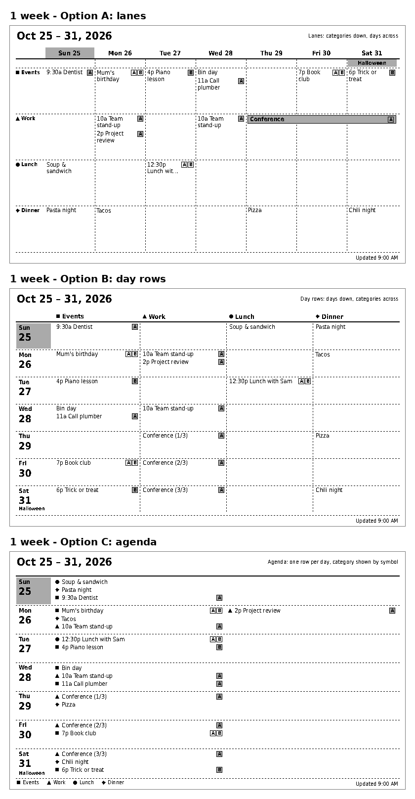
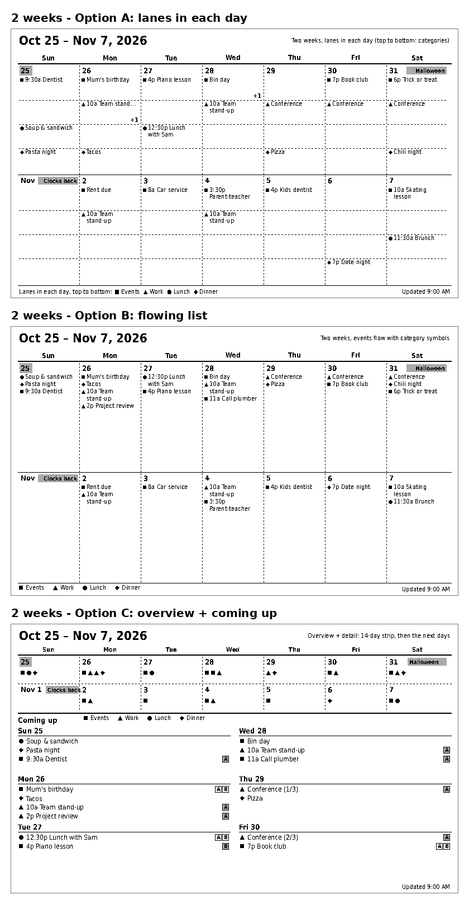

# 16 - Layout options for the 1-week and 2-week views

Status: **Design exploration, 2026-10-25.** Mock-ups drawn with a throwaway script
(`assets/options/make_mockups.py.txt`, saved as text so it is not mistaken for app code), not the
real renderer. They show the 800x480, 2-bit (four grey) output with crisp text, using sample data:
Sunday 25 October 2026 as today, four categories (Events, Work, Lunch, Dinner), two placeholder
people **A** and **B** shown as boxed initials (grey box = owner), a multi-day event
(Conference), and holiday banners (Halloween, clocks go back).

Owner direction so far: 7 days is preferred over 5 (`15`).

## One week



| Option | Shows | Strengths | Weaknesses |
|--------|-------|-----------|------------|
| **A. Lanes** (days across, categories down) | Matches the section model: each category is a horizontal lane. Multi-day events draw as one bar. | Best "at a glance" feel for category; empty lanes show free time; holiday banner fits naturally | Narrow columns (about 102 px): titles wrap to two lines or truncate ("Lunch wit..."); capacity per cell is about 5 lines |
| **B. Day rows** (days down, categories across) | Each day is a row with one column per category | Wide cells (about 175 px) so titles read in full; easy to scan a single day | Seven rows leave about 3 lines per cell; multi-day events repeat each day ("Conference (2/3)") |
| **C. Agenda** | Each day is a row of lines; the category is a symbol (square, triangle, circle, diamond) | Scales to 8 categories without redesign; uses space only where events exist | Category is shown by symbol, not position; needs a legend |

## Two weeks



| Option | Shows | Strengths | Weaknesses |
|--------|-------|-----------|------------|
| **A. Lanes in each day** | Two rows of seven days; each day has four category lanes, one event each | Category stays spatial; consistent with the 1-week lanes view | Wastes space in empty lanes; busy days collapse to "+1"; titles truncate ("10a Team stand...") |
| **B. Flowing list** | Each day lists its events top to bottom, category as a symbol | Best use of space; the mock-up still has room to spare, so text could be larger | No person badges at this size; category by symbol only |
| **C. Overview + coming up** | A 14-day strip of category symbols on top, then a detailed list of the next six days | Combines the two-week picture with readable detail for the near term | The second week has no detail; busiest layout to build |

## Observations

- **Text is 11 to 12 px.** Whether that is comfortable on the physical panel is unverified; see the
  preview step below.
- **Person badges** fit in the 1-week options. In the 2-week options there is no room beside the
  titles, so a view would show a badge only when it filters or colours by person.
- **Untimed meals sort before timed items** in the agenda (Sunday: lunch and dinner above the
  9:30 dentist). The real ordering rule needs deciding: category order first, or time first with
  untimed items last.
- **Category lanes need a minimum height.** At four categories every option works; the fit check
  (`15`, V-4) must say when more categories would not fit.
- All six are the same data drawn by different layout modules, so offering several costs little.

## Recommendation (for discussion)

| View | Default | Also worth shipping |
|------|---------|---------------------|
| 1 week | **A. Lanes** (clearest link to categories) | **C. Agenda** for people who add many categories; **B** if long titles matter |
| 2 weeks | **B. Flowing list** (best density) | **C. Overview + coming up** as a second two-week layout |

Everything in the MVP uses the same layout-module interface (`04`), so the first slice builds one
of these end to end and the others are added as modules.

## See them on the device

The pictures cannot show real e-paper contrast and grain. To see them on the panel, run on the
Terminus host:

```bash
python3 terminus-spike.py --push-file assets/options/1week-A-lanes.png assets/options/2week-B-flow.png --playlist-id 7
```

Each file becomes a screen in playlist 7 (converted to the model's exact 2-bit format). They are
not deleted afterwards; remove them in the Terminus Screens page when done.

## Update 2026-10-25: owner feedback

Initial feedback (owner and wife) was good. **Both recommended views, Week - lanes and Two weeks -
list, are to be offered as templates** in the view editor, and users can build their own with a
live native-size preview. Trips that span days, drawn as bars, are shown in `17`.
