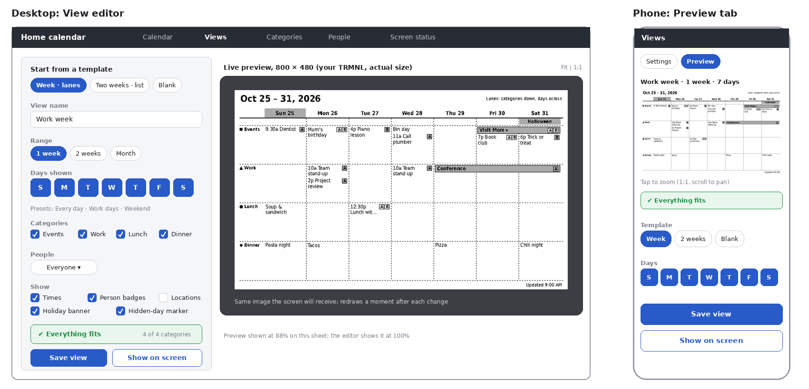
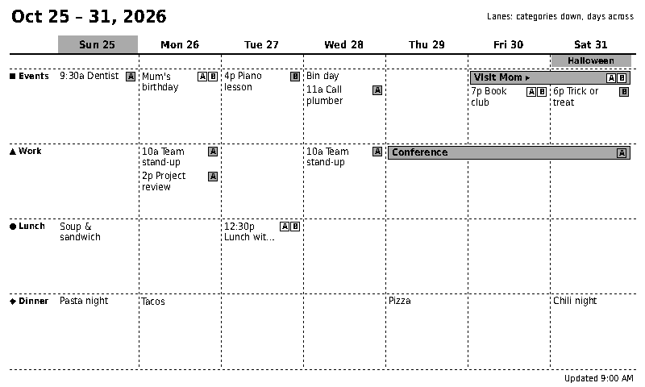
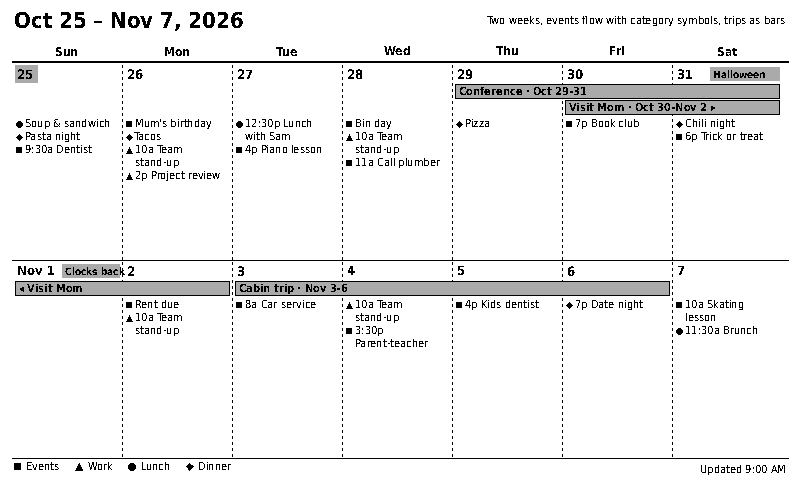

# 17 - View editor, recurring events and multi-day events

Status: **Design, 2026-10-25.** Captures the owner's second round of feedback (after the six
layout options in `16` were shown on the device and to the wife). Folded into `03`, `04`, `06`
and `07` after the open questions are answered.

## Feedback recorded

1. The initial feedback on the options was good. **Both views are offered as templates** when
   configuring a view: **Week - lanes** (1-week option A) and **Two weeks - list** (2-week
   option B). The other four options in `16` become further templates later.
2. The owner can **create his own view** and wants a **preview showing how it will actually look
   at the TRMNL's native resolution**.
3. Feature request: **recurring events** (weekly, biweekly, monthly, and so on).
4. Feature request: an event with a **start and end date, such as a trip, spans the days** on
   the calendar view.

## 1. View editor

| Part | Behaviour |
|------|-----------|
| Templates | "Week - lanes", "Two weeks - list" and "Blank" to start from. A template is copied into the new view; editing the view never changes the template. |
| Settings | Name; range (1 week, 2 weeks, month); the days shown (any subset of the seven days, with Every day, Work days and Weekend as presets); categories; people; and which fields to show (times, person badges, locations, holiday banner, hidden-day marker). |
| Live preview | The server renders the **same image the screen will receive**, at the display's native size (800 x 480 for the owner's TRMNL), using the same render function as the push. It refreshes a moment after each change (debounced). The preview is therefore exactly what the device gets, apart from how the panel itself draws it. |
| Zoom | **Fit** scales the image to the window; **1:1** shows the real pixels (scroll to pan). On a phone the preview opens in Fit, and a tap zooms to 1:1. |
| Fit check | A status line under the settings: "Everything fits", or a warning such as "2 events are hidden in Monday's Work lane". Computed by the layout, not guessed. |
| Actions | **Save view** keeps it; **Show on screen** makes it the display's active view and pushes it. Leaving with unsaved changes asks first. |
| Phone | Two tabs, Settings and Preview, so each gets the whole width. Large touch targets (`15`, M-2). |

Preview endpoint (design for `06`): a request carrying a view's unsaved settings returns a PNG;
nothing is stored and nothing is pushed.

## 2. Recurring events

The data model already covers the request (`03`): a repeat rule is `freq` (daily, weekly,
monthly, yearly), `interval` (every N), `by_weekday` (weekly only) and an optional `until`.
**Biweekly is weekly with an interval of 2.**

| Add-form choice | Stored as |
|-----------------|-----------|
| Does not repeat | `freq = none` |
| Every day | daily, interval 1 |
| Every week | weekly, interval 1, weekday of the start date |
| Every 2 weeks | weekly, interval 2 |
| Every month | monthly, interval 1 |
| Every year | yearly, interval 1 |
| Custom... | any interval, chosen weekdays, and an end: never, on a date, or after N times (the first occurrence counts; skipped dates still count) |

The form says it in words ("Repeats every 2 weeks on Thursday, until 30 June") so nobody has to
decode the settings. Editing a repeating event changes the whole series; "skip this one" removes a
single date (`event_exceptions`). Changing only one occurrence, or "this and following", is not in
v1.

**Nth-weekday repeats** ("the first Monday of every month", "the last Friday of the month") are
included, but **tucked away**: the repeat menu shows Never, Daily, Weekly, Every 2 weeks, Monthly
and Yearly, then **More options...** opens a panel with custom intervals, chosen weekdays, and
"Monthly on the first Monday / last Friday" (the form suggests the matching pattern from the
selected date). They need two more fields, `month_mode` and `month_nth` (`03`).

## 3. Multi-day events (trips)

`events.start_date` and `end_date` already exist. What was missing was the drawing rule:

Rules for layouts (to be carried into `04`):

1. A multi-day event is one **continuous bar** across its visible days in a row. The first segment
   shows the date range ("Cabin trip - Nov 3-6").
2. When the event runs past the end of a row, or over a hidden day, the bar **breaks**. The cut
   end has an arrow, and the continuation repeats the title with a leading arrow.
3. Lane layouts draw the bar in the event's **category lane**; flowing-list layouts draw bars in a
   **strip above the day lists**, stacked when they overlap. Layouts that are lists (day rows,
   agenda) repeat the event as "Title (day 2/4)".
4. The strip height is part of the **fit check**; many overlapping trips collapse to "+N".
5. Times show on the first day only. A repeating multi-day event draws every occurrence the same
   way.

## 4. Data-model and roadmap consequences

| Item | Effect |
|------|--------|
| Spans | No schema change; layout rules only. |
| Recurrence | No change for weekly, biweekly, monthly (by date) and yearly. "Nth weekday of the month" would add `month_mode` and `month_nth` to `events`. |
| Views and templates | Already planned (`views` table, `15`); a view stores the layout name and its options, so templates need no schema. |
| Roadmap | Slice 2: recurrence form and trips. Slice 3: view editor, templates and live preview. |

## 5. Open questions

| ID | Question | Recommendation |
|----|----------|----------------|
| R-1 | Nth-weekday repeats | **Decided 2026-10-25:** included, hidden under "More options..." (owner). |
| R-2 | "This and following" edits | **Decided 2026-10-27:** not in v1; edit the whole series or skip one date. |
| R-3 | Times on multi-day events | **Decided 2026-10-27:** optional start time on the first day and end time on the last day. |

## 6. Rotating weeks (owner request 2026-10-29)

A repeat rule can be a rotation: a list of 2 to 4 weeks, each a set of weekdays, repeating in order from
the week containing the start date (Monday-to-Sunday weeks, independent of the calendar's week start).
Skips, `until`, `count`, people and categories behave as for any repeat. Per-day "in/out" notes are stored
apart from the rule (`event_day_notes`) so the rule never changes when a status does. See `03`, `06`, `07`.
